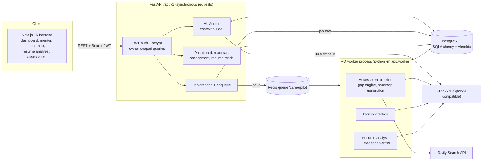
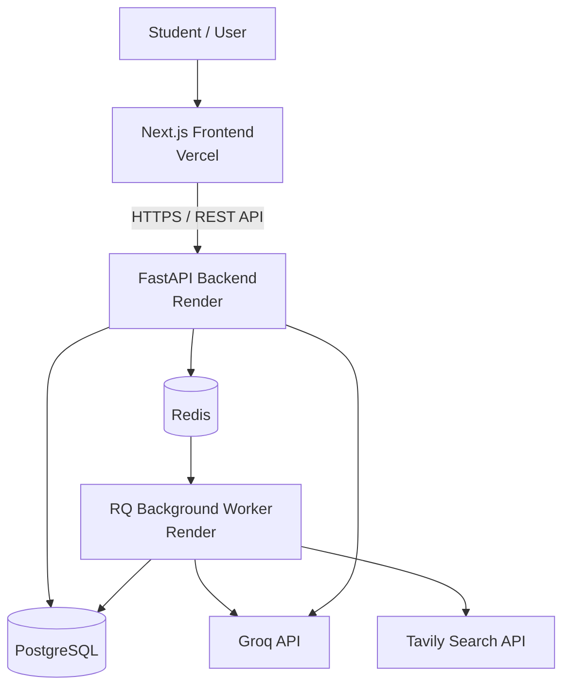

# CareerPilot AI

**An AI career coach that knows your skills, plans your learning, and checks its own claims.**

[](frontend) [](frontend) [](frontend) [](frontend) [](backend) [](docker-compose.yml) [](docker-compose.yml) [](#ai-design-at-a-glance) [](#why-web-search-instead-of-a-vector-rag-pipeline) [](.github/workflows/ci.yml)

| | |
| --- | --- |
| **Live Demo** | [CareerPilot AI](https://frontend-two-sand-84.vercel.app/) |
| **API Health** | [Check API Health](https://careerpilot-ai-backend-6n55.onrender.com/api/v1/health/ready) |
| **API Documentation** | [Swagger UI](https://careerpilot-ai-backend-6n55.onrender.com/docs) |
| **Repository** | [GitHub Repository](https://github.com/shafiqahmed-786/careerpilot-ai) |

<!-- DEPLOYED_URL: replace the placeholders above after you deploy. Nothing in this repository claims a deployment exists. -->

## The problem

A student can name a target job ("backend engineer", "AI engineer") and still not know which skill to practise first, which learning material is worth opening, whether a skill on their resume would survive a question about it, or what to do when they fall behind. A chat answer disappears, forgets the profile, and cannot be ticked off. A static roadmap never changes.

## What CareerPilot does

CareerPilot is a personalized career-intelligence and learning platform, not a chatbot and not a one-shot roadmap generator. It keeps your profile, assessment, roadmap, resume analysis and conversations in one account and uses all of them:

- **Assesses** your skills against a role rubric with deterministic, reproducible scores (no model invents numbers).
- **Plans**: an LLM writes a weekly roadmap (objectives, milestones, project-based tasks, measurable completion criteria, hours, links) from those scores, your hours and your experience. Output is validated; if it fails, a labelled deterministic fallback is used.
- **Verifies**: a resume analyzer separates skills *demonstrated by evidence* from skills *merely listed*, and an independent verifier rejects any quote that does not actually support the skill.
- **Mentors**: a persistent AI mentor receives a compact summary of your real database state (gaps, tasks done and pending, resume evidence), not a blank prompt.
- **Adapts**: on request, only your unstarted tasks are re-planned from observed progress; completed work is kept.
- **Is honest about AI**: every AI-produced artifact stores and displays its real provider (`groq` or `demo`). With no API keys, everything still works and says so.

Supported target roles (rubric catalog): Backend, Frontend, Full Stack, Software, Machine Learning (also matches "AI Engineer"), DevOps, QA, Data Analyst, Data Scientist. Unknown roles use the Software Engineer rubric.

## How this meets the brief

| Requirement | Where it is met |
| --- | --- |
| Free choice of problem; "AI Career Coach" | Help students decide what to learn, find relevant content, and pursue a goal: [assessment](#ai-design-at-a-glance), [resource discovery](#why-web-search-instead-of-a-vector-rag-pipeline), [roadmap](#ai-generated-personalized-roadmap), [mentor](#ai-career-mentor), [progress tracking](#dashboard-and-progress-metrics) |
| New project, fresh public repo | Standalone codebase, no RuFlow or MedResearch code. Repository: `[Add public GitHub repository URL]` |
| 5-6+ components | Frontend (Next.js), API (FastAPI), database (PostgreSQL), background worker and queue (RQ + Redis), AI (Groq + Tavily + rule engine), auth (JWT + bcrypt). See [Architecture](#architecture) |
| Built with AI coding agents; spec and plan docs in the repo | [Workflow](#ai-native-development-workflow); [PRD](docs/PRD.md), [Architecture](docs/ARCHITECTURE.md), [Implementation plan](docs/IMPLEMENTATION_PLAN.md), [AI decisions](docs/AI_ENGINEERING_DECISIONS.md), [Data model](docs/DATA_MODEL.md), [Decision log](docs/DECISION_LOG.md), [Testing strategy](docs/TESTING_STRATEGY.md); agent notes in [CLAUDE.md](CLAUDE.md) and [AGENTS.md](AGENTS.md) |
| Tests | 12 backend test modules and 5 frontend test files. See [Testing](#testing-and-verification-status) for the exact verification state |
| CI | [`.github/workflows/ci.yml`](.github/workflows/ci.yml) |
| Deployed link | `[Add deployed application URL after deployment]`; config in [`render.yaml`](render.yaml), see [Deployment](#deployment) |
| README covers architecture and key decisions | [Architecture](#architecture), [Why web search](#why-web-search-instead-of-a-vector-rag-pipeline), [Engineering decisions](#key-engineering-decisions) |

## Screenshots

No screenshots are committed, and none are fabricated here. After running the app, add captures to `docs/screenshots/` and link them below.

| Screen | File to add |
| --- | --- |
| Dashboard | `docs/screenshots/dashboard.png` |
| AI Career Mentor | `docs/screenshots/mentor.png` |
| Roadmap with adapt panel | `docs/screenshots/roadmap.png` |
| Resume Analyzer | `docs/screenshots/resume-analyzer.png` |
| Skill Assessment | `docs/screenshots/assessment.png` |

## Architecture



### Synchronous vs asynchronous flow

| Flow | Path | Why |
| --- | --- | --- |
| **Synchronous** (request/response) | Auth, profile, task updates, dashboard, reads, **mentor messages**, resume upload validation and text extraction | Must feel instant. The mentor call is bounded by a 40 s timeout and falls back to a labelled template answer |
| **Asynchronous** (queued job) | `POST /assessments` (full pipeline), `POST /roadmaps/current/adapt`, `POST /resume/analyze` (analysis step) | Slow, external, and failure-prone. API inserts an `assessment_jobs` row (`queued`), puts its id on Redis, returns `202`; the worker sets `running`, does the work, and sets `completed` or `failed`; the browser polls `GET /jobs/{id}` (the dashboard also reads `latest_job`) |

One queue and one worker serve all three job kinds via `assessment_jobs.kind` (`assessment`, `adapt`, `resume`). If Redis is down, the API marks the job `failed` and returns `503` rather than pretending it queued.

### Repository layout

```text
backend/
  app/
    main.py            app, CORS, error handling, /health and /health/ready
    api.py             auth, profile, assessments, jobs, roadmaps, tasks, dashboard, adapt
    routes_mentor.py   mentor conversations and messages
    routes_resume.py   resume upload, latest, apply-to-profile, delete
    security.py        bcrypt hashing, JWT creation and verification
    models.py          SQLAlchemy models (11 tables)
    schemas.py         Pydantic request/response and AI-output schemas
    catalog.py         role rubrics, demo resource catalog (rubric importance-x-gap-v1)
    gaps.py            deterministic gap scoring and focus-skill selection
    search.py          Tavily discovery with labelled demo-catalog fallback
    roadmap_ai.py      LLM roadmap prompt, schema, validation, fallback
    roadmap_builder.py deterministic roadmap builder (the fallback)
    adaptive.py        progress-aware replanning helpers
    mentor.py          context builder, prompt, demo reply
    resume_analysis.py upload validation, text extraction, LLM + keyword analysis, role comparison
    evidence.py        independent per-skill evidence verification (stdlib only)
    metrics.py         readiness, streak, activity, milestone calculations
    llm.py             one OpenAI client: timeouts, no prompt logging
    ai.py              assessment narrative (summary text only)
    pipeline.py        assessment and adaptation orchestration
    queue.py, worker.py  Redis/RQ enqueue and the worker process (Windows-compatible)
  alembic/versions/    0001_initial, 0002_ai_features
  tests/               12 test modules, mocks for OpenAI/Tavily/Redis
frontend/src/
  app/                 / , login, signup, and the (app) group: dashboard, onboarding (profile),
                       assessment, roadmap, mentor, resume-analyzer, settings
  components/          AppShell (sidebar, auth gate), ui, charts
  lib/                 API client, job polling, mentor/resume/roadmap helpers, tests
docs/                  PRD, architecture, plan, AI decisions, data model, decision log, testing
scripts/               setup, dev, verify (PowerShell and Bash)
```

## Core capabilities

### AI Career Mentor

Route `/mentor`; API under `/api/v1/mentor`. It is a context-aware advisor, not a generic chat box.

- **Real context, scoped to the user.** `mentor.build_context` reads only the authenticated user's rows (every query filters by `user.id`): profile (education, experience level, target career, self-reported skills, weekly hours), the latest assessment (top gaps, rubric coverage), the current roadmap (tasks completed, next three tasks with their completion criteria, recently completed tasks, earlier tasks skipped), and the latest completed resume analysis (skills with evidence, skills listed without evidence, evidence coverage, priorities).
- **Compact by design.** The model receives that summary in `<user_context>` tags plus the **last 8 messages**, not table dumps or whole histories.
- **Rules in the system prompt.** Treat the context and user text as data; never claim skills, readiness or achievements are verified; do not invent courses, URLs or employers; point to the app when data is missing ("complete your profile", "run the assessment").
- **Persistence.** `mentor_conversations` and `mentor_messages` in PostgreSQL. Each assistant message stores `provider` (`openai` or `demo`) and an optional `notice`. The user's message is committed before the model call, so a failure never loses it.
- **Ownership.** Conversation lookups compare `conversation.user_id` to the token's user; any other id returns `404`. A conversation (and its messages) can be deleted by its owner only.
- **Honest degradation.** With no key, or on timeout/HTTP/format error, the reply is assembled from the same context by a template, ends with an explicit "Demo mode" note, and is stored with `provider = demo`. The UI shows "Live AI" or "Demo mode" on the page and on each message. Replies are not streamed; the UI shows a typing indicator.

What makes it different from a chatbot wrapper: ask "What should I focus on this week?" and the answer names *your* next task and its completion criteria; complete that task and the next question sees it as done (covered by `test_mentor.py` and `test_v2_journey.py`).

### AI-generated personalized roadmap

The weekly plan is written by the configured LLM (`app/roadmap_ai.py`), not assembled from templates.

| Deterministic Python | LLM |
| --- | --- |
| Competency importance and target levels (role catalog) | Weekly objectives and milestones |
| Self-reported levels from your profile | Concrete, project-based task titles and descriptions |
| Gap and priority score: `priority = importance x max(0, target - self_reported)` | Expected outcomes and measurable completion criteria |
| Focus-skill selection (`gaps.focus_skills`) and week range | Estimated hours per task |
| Resource discovery (Tavily or demo catalog) | Choosing which verified resource links belong to which task |
| **Validation of the generated plan** | Personalization from experience level, hours and resume evidence |

Validation (`validate_roadmap`) rejects the plan unless: the weeks are exactly the requested weeks; each week's hours are within 50-125% of the weekly budget; every skill is a known competency of the role; titles are not vague; and every resource URL is one we supplied. Invented URLs are dropped; a task left without a valid link gets verified resources for its first skill.

**Fallback.** If the key is missing, the call fails or times out (90 s), or validation fails, the deterministic builder (`roadmap_builder.py`) produces the plan. The roadmap stores `source = "fallback"` and `provider = "demo"`, and the UI labels it "Template plan (deterministic fallback)". A fallback plan is never presented as AI-generated; `source = "ai"` is stored only after validation passes.

The model is told to treat profile text as untrusted data. Assessment *narrative* text (summary and "learn first" reason) is a separate, small LLM call whose schema contains no scores or URLs.

### Adaptive learning roadmap

`POST /api/v1/roadmaps/current/adapt` queues an explicit, user-triggered revision (modes: `revise`, `intensive` (+50% hours, capped at 40), `lighter` (60% of hours, minimum 1), `focus` on one skill of the target role). Nothing is rebuilt automatically when you tick a task.

- **Preserved:** `completed` and `in_progress` tasks, with their notes and timestamps.
- **Replaced:** only `pending` tasks. The new plan covers the weeks after your last completed week through the end of the original timeline.
- **Progress evidence (deterministic):** every 6 completed study hours on a skill raise its *planning* level by one, capped at the target, and priorities are recomputed for the next plan. Skipped earlier tasks and completed hours per skill are passed to the model as context. The stored assessment is not modified.
- **Not proficiency.** Completion is observed activity, not verified ability. The heuristic only re-ranks what to study next; the UI and docs call levels "self-reported" and coverage "rubric coverage".
- **Same safeguards:** the revised plan goes through the same schema validation and labelled fallback. The roadmap records `adapted_count` and an `adaptation_note` summarizing what was kept and replaced.

### Resume Analyzer and evidence verification

Route `/resume-analyzer`; API `POST /api/v1/resume/analyze` (multipart), `GET /resume/latest`, `POST /resume/{id}/apply-to-profile`, `DELETE /resume/{id}`.

**Workflow.**

1. **Upload validation** (synchronous): extension (`.pdf`/`.docx`), declared content type, file signature (`%PDF-`, `PK`), 5 MB limit, PDF page cap, encrypted/corrupt/empty files and scanned documents without text are rejected with specific messages. The file is only ever read as bytes in memory, never executed or saved. DOCX text is read with a size-checked zip read and regexes (no XML parser).
2. **Queue:** extracted text is stored on a `resume_analyses` row; a `resume` job is enqueued.
3. **Analysis** (worker): OpenAI returns a structured JSON analysis (education, experience, projects, technologies, achievements, strengths, improvements, gaps, recommended projects, per-skill evidence) validated by Pydantic. Without a key, or on failure, a conservative keyword analysis runs and is labelled demo.
4. **Verification:** `app/evidence.py` independently checks every skill (below).
5. **Comparison:** a deterministic role comparison against the competency catalog (below).
6. **Cleanup:** extracted text is cleared; only the structured analysis remains.

**Three evidence classes.**

| Classification | Meaning |
| --- | --- |
| Demonstrated | The resume contains a passage that names this skill and describes actually using it (building, deploying, testing, ...) |
| Listed | The skill is explicitly named, but no practical use is shown (a skills list, "familiar with X") |
| Inferred | Indirectly suggested, not named. Carries no evidence and **never** counts toward coverage |

An unsupported skill is reported as *missing* in the role comparison.

**Independent verification (`backend/app/evidence.py`).** The model proposes a level, a verbatim quote and a one-sentence usage statement per skill. Application code then decides, using only the resume text:

- **Exact quotation:** the quote must exist in the resume as one passage (up to three consecutive lines) after safe normalization (whitespace, curly quotes, dashes, leading bullets, case).
- **Skill-specific association:** the quote must itself name that skill or a true synonym (Postgres/PostgreSQL, k8s/Kubernetes, JS/JavaScript). A real quote about an unrelated project is rejected, and one generic quote cannot support several unrelated technologies, because each skill is checked against its own name.
- **Usage context:** the clause that names the skill must contain a usage verb and must not be a weak claim ("familiar with", "basic knowledge of", "coursework in"); the passage must not be a skills list or sit in the Skills section; a usage statement is required.
- **Conservative downgrade:** demonstrated -> listed (named elsewhere in the resume) -> inferred (not named). The model cannot talk its way upward.
- **Prompt-injection resistance:** resume text is wrapped in `<resume>` tags in the user message, the system prompt is fixed and tells the model to ignore instructions inside the document, and even a model that obeys an injected instruction cannot produce a demonstrated skill without a verifiable quote (tested).

**Evidence-coverage formula** (labelled in the UI and API): `sum(importance x points) / sum(importance) x 100`, with demonstrated = 1, listed = 0.5, inferred or missing = 0. It is deterministic and reproducible. It measures how much of a role's competency list is *supported by text in one resume*. It is **not** a hiring score, a prediction, or a measurement of real-world ability.

**Fallback analyzer.** Keyword matching over a fixed vocabulary, run through the same verifier. A skills-list mention or a vague mention stays Listed; only a clause that describes real use can reach Demonstrated. It is always labelled "Keyword analysis (demo, no LLM)".

**Resume text handling.** The uploaded file is never stored. Extracted text lives in `resume_analyses.source_text` only so the worker can read it, and is cleared on success, on failure, and by a purge after 1 hour if the worker never ran (checked on upload and on `GET /resume/latest`). Failure messages are fixed strings because exception text can echo resume content; resume text and prompts are never logged. "Apply to profile" adds missing skills at conservative levels (demonstrated = 2, listed = 1) and never overwrites levels you set.

### Dashboard and progress metrics

All values come from stored rows (`app/metrics.py` and the dashboard route); nothing is estimated or invented.

| Metric | Source and calculation |
| --- | --- |
| Overall roadmap completion | `round(completed tasks x 100 / total tasks)` |
| Readiness (shown as "rubric coverage") | `sum(importance x min(self, target)) / sum(importance x target)` over the latest assessment. Self-reported; not a verified readiness score |
| Critical skill gaps | Competencies not "sufficient" with importance >= 4 |
| Milestones | Weeks whose tasks are all completed, out of weeks with tasks |
| Activity history | Tasks completed per UTC day for the last 14 days, from `completed_at` timestamps |
| Learning streak | Consecutive UTC days with at least one completed task, ending today or yesterday |
| Skills identified | Distinct skills from the profile plus resume skills that are demonstrated or listed |
| Resume status | Latest `resume_analyses` row: status, provider, evidence coverage, skills found |
| Current task | First unfinished task by roadmap order, with its completion criteria |

New users see empty states, not placeholder numbers.

### Assessment and resources

The assessment is deterministic (rubric `importance-x-gap-v1`; see [AI decisions](docs/AI_ENGINEERING_DECISIONS.md)). Learning resources come from Tavily when `TAVILY_API_KEY` is set, otherwise from a predefined catalog of real public URLs; each row stores title, URL, domain, snippet, skill and `provider` (`tavily` or `demo`), and the UI says "Demo catalog, not live search" when applicable.

## AI design at a glance

| Responsibility | Done by |
| --- | --- |
| Importance, targets, levels, priority scores, gap status, focus skills, plan validation, readiness, evidence coverage, streaks, authorization, input validation | **Python** (deterministic, tested) |
| Assessment narrative, roadmap content, resume skill/evidence extraction, mentor answers | **OpenAI** (optional), always validated or labelled |
| Learning links | **Tavily** or the predefined catalog; model-supplied URLs outside that list are discarded |

- **Structured outputs:** Pydantic models for roadmap, resume analysis and narrative; invalid output triggers the fallback.
- **Context engineering:** summaries and bounded history, not raw data.
- **Provider transparency:** `provider` stored on assessments, roadmaps, resume analyses and every mentor message.
- **Cost and safety:** one call per operation, bounded `max_tokens`, timeouts on every call (mentor 40 s, resume 75 s, roadmap 90 s), no retries, prompts and responses not logged, keys only on the backend.

## Why web search instead of a vector RAG pipeline

**The question:** why does CareerPilot find learning material with Tavily web search rather than a vector database with embeddings?

**The decision is driven by the product's job.** CareerPilot must help a student *discover relevant, current learning material for a target career*. That material (official documentation, tutorials, courses) lives on the public web, changes often, gets moved or replaced, and has an authoritative source URL.

| Factor | Why web search fits this MVP |
| --- | --- |
| Freshness | Search finds what is available now. An owned index goes stale unless it is continuously re-crawled and re-ingested |
| Source traceability | Each result keeps its original URL, domain and snippet, and is shown to the user as a link to the authoritative source |
| Problem fit | The need is resource discovery across the open web, not semantic retrieval over a private corpus we own |
| Engineering simplicity | No crawling, chunking, embedding generation, vector-index maintenance or re-indexing jobs |
| Cost and latency | A managed search call per focus skill is cheaper to run and operate than ingestion plus retrieval infrastructure at MVP scale |
| Grounding | Retrieved resources (skill, title, URL) are supplied to roadmap generation, and the model may only link to those URLs |

**Exactly what is implemented.**

1. `app/search.py` calls Tavily's `/search` endpoint per focus skill (query: official documentation or an established course for the skill and role), keeps up to two `https` results with URL, domain and a length-limited snippet, and stores them as `learning_resources` rows with `provider = tavily`. Page text is treated as untrusted data.
2. If Tavily is not configured, errors, or returns nothing usable, a predefined catalog of verified public URLs is used for that skill and labelled `provider = demo`.
3. The roadmap prompt receives each resource's skill, title and URL (snippets are stored and shown in the UI but are not sent to the model). The LLM generates the personalized plan from the structured profile, the deterministic gap data and this resource list; application code then validates that every link on a task is from that list.

**What this is not.** There is no vector database and no embeddings-based RAG pipeline in this project, and this README does not claim one. This is an intentional MVP choice, not a claim that RAG is inferior: vector retrieval is the right tool when an application needs semantic search across a controlled or growing document collection, such as internal knowledge bases, proprietary files, or long-lived indexed content.

**Extension path.** If CareerPilot gains such content (a curated learning-resource library, course syllabi or the user's own notes), the natural step is hybrid retrieval: keep live search for freshness and add a vector index over the curated corpus, merging results through the same `ResourceDraft` and URL-validation path so grounding guarantees stay unchanged.

## Key engineering decisions

Each decision: problem, decision, why, trade-off. Longer reasoning lives in the [decision log](docs/DECISION_LOG.md) and [AI engineering decisions](docs/AI_ENGINEERING_DECISIONS.md).

| Decision | Problem | Choice and reasoning | Trade-off |
| --- | --- | --- | --- |
| **Deterministic gap scoring** | An LLM asked for "skill scores" gives different numbers per call and cannot be tested or explained | Scores are `importance x gap` in `gaps.py`; the LLM never sees a chance to change them | Rubric is a fixed catalog of 9 roles, so unusual roles map to the nearest rubric |
| **LLM roadmap with application-level validation** | Templates feel generic; unvalidated LLM output can break constraints or invent links | The LLM writes content; Pydantic schema plus `validate_roadmap` enforce weeks, hours, skills, vagueness and URL grounding; labelled deterministic fallback | One failed validation discards a whole AI plan (no repair loop) |
| **Web search over vector RAG** | Learning links are public, fresh and URL-addressed | Tavily with labelled demo fallback; see [above](#why-web-search-instead-of-a-vector-rag-pipeline) | No semantic retrieval over private content, by design for now |
| **Structured evidence instead of keyword proficiency** | A keyword on a resume is not proof of skill, and models over-claim | Three classes plus `evidence.py` verification; conservative downgrades; inferred never counts | Stricter than a human reader: unusual phrasing shows as Listed |
| **FastAPI + Pydantic** | Need typed, modular routes and one place to validate untrusted input and model output | Routers per area, Pydantic for requests and AI output | Python worker and API share models, so schema changes touch both |
| **Next.js + TypeScript** | Multi-page authenticated app with shared shell and typed API client | App Router, `(app)` route group with one `AppShell` auth gate, a single `api.ts` client that turns every failure into a readable message | Token in `localStorage` (MVP trade-off) |
| **PostgreSQL + SQLAlchemy + Alembic** | Relational ownership (`user_id` on every table), constraints, evolving schema | Durable relational model; migrations `0001`, `0002` | SQLite in tests means the migration uses portable types |
| **Redis + RQ with a separate worker** | Scoring, search and LLM calls are slow and can fail | API returns `202` with a job row; one worker, three job kinds; Windows-compatible `WindowsWorker` | The Windows worker does not enforce RQ's job timeout |
| **Mentor in-request, not queued** | Chat must feel responsive | Synchronous call with a 40 s timeout and a labelled template fallback | A slow model call holds a request thread; no streaming |
| **JWT + bcrypt** | Simple stateless auth with no external provider | Expiring HS256 tokens, bcrypt hashes, 72-byte password rule enforced (never silently truncated), owner filter on every query | No refresh tokens, email verification or password reset |
| **Transparent fallbacks** | Missing keys or provider outages must not break the product or mislead | Every AI feature has a deterministic path and a `demo` label stored with the data | Demo outputs are simpler than live ones |
| **Temporary resume text** | Analysis needs the text, but resume content is sensitive | Never store the file; clear extracted text on success, failure and by purge | Text exists briefly in the database during analysis |

## AI-native development workflow

This repository was built with Claude-based AI coding agents working against written specifications, with a human reviewing and directing each step.

1. **Specify first.** Product requirements and scope in [docs/PRD.md](docs/PRD.md); component design in [docs/ARCHITECTURE.md](docs/ARCHITECTURE.md); schema in [docs/DATA_MODEL.md](docs/DATA_MODEL.md).
2. **Plan and record decisions.** [docs/IMPLEMENTATION_PLAN.md](docs/IMPLEMENTATION_PLAN.md), [docs/AI_ENGINEERING_DECISIONS.md](docs/AI_ENGINEERING_DECISIONS.md) and [docs/DECISION_LOG.md](docs/DECISION_LOG.md) capture what was chosen and why, including what was deliberately not built (agent frameworks, vector store).
3. **Constrain the agent.** [CLAUDE.md](CLAUDE.md) and [AGENTS.md](AGENTS.md) tell coding agents what to preserve (ownership checks, separate worker, the demo/live labelling), where code lives, and what not to add.
4. **Implement iteratively.** Features were added in focused passes (stabilization and auth fixes, application shell and dashboard, mentor, AI roadmap and adaptation, resume analyzer, evidence verification), with defects found by reading code and fixed at the cause, for example: unhandled 500s lacking CORS headers (masked as "Failed to fetch"), `pytest` not finding the `app` package, and resume quotes that existed in the text but did not support the claimed skill.
5. **Verify with focused tests.** Each behavior change was paired with tests that mock external services ([Testing strategy](docs/TESTING_STRATEGY.md)).
6. **Human review and Git.** Changes were reviewed before being kept and committed as milestones; run `git log --oneline` for the history.

Only Claude-based agents were used for the work documented here; no Codex workflow is claimed.

## Testing and verification status

**What exists.**

| Area | Coverage |
| --- | --- |
| Authentication | Signup/login, email normalization, duplicate and concurrent-duplicate signup, 72-byte password rule, expired and invalid tokens (`test_auth.py`) |
| Ownership | Jobs, tasks, conversations, resumes return `404` to other users (`test_api.py`, `test_mentor.py`, `test_resume*.py`, `test_adapt.py`) |
| Background jobs | Real RQ `SimpleWorker` over fakeredis for assessment, adapt and resume jobs, including failed jobs |
| Scoring | `test_gaps.py`, `test_schemas.py`, `test_search.py` |
| AI integrations (mocked) | OpenAI is patched at `app.llm.chat` / `app.llm.chat_json`; Tavily falls back to the demo catalog. No test needs a key or network |
| AI roadmap | Valid plan accepted, invented URLs dropped, invalid output / errors / no key fall back, schema rejections (`test_roadmap_ai.py`) |
| Adaptation | History preserved, pending replaced, modes, adaptive priorities (`test_adapt.py`) |
| Resume and evidence | Upload validation, extraction, unrelated/hallucinated/missing quotes, weak mentions, whitespace tolerance, inferred never raising coverage, conservative fallback, text cleared on success and failure, abandoned-text purge, prompt injection (`test_resume.py`, `test_resume_evidence.py`) |
| Mentor | Context scoped to the user, live vs demo, bounded history, failure fallback, progress reflected in later prompts (`test_mentor.py`) |
| End to end | Signup -> profile -> resume -> AI roadmap -> mentor -> complete task -> later guidance -> adapted plan (`test_v2_journey.py`) |
| Frontend | Vitest: API error formatting, form validation, mentor message handling, resume upload validation, roadmap helpers, progress helpers |
| CI | [`ci.yml`](.github/workflows/ci.yml): backend `ruff check app tests` and `python -m pytest -q`; frontend `npm ci`, `lint`, `typecheck`, `test`, `build`; `docker compose --profile app config --quiet` |

**Verification state, stated plainly.** The development environment used for the most recent changes had no network access, so backend dependencies and npm packages could not be installed there. As a result:

- The **full backend suite (`python -m pytest -v`) has not been executed in a complete environment** at the time of writing, and neither have `ruff`, the Alembic migrations against a database, `npm ci`, lint, Vitest, `next build`, or Docker. No pass count is claimed.
- What *was* executed: Python compilation of the backend and tests, static scans for unused imports and undefined names, the evidence verifier and keyword fallback run directly with minimal stand-in modules, and the new frontend helper logic run under Node. These are smoke checks, not the test suite.

Run the real checks yourself before relying on this (commands below); CI will run them on the first push.

```bash
# backend (from backend/, with the venv active)
python -m pip install -r requirements.txt
python -m ruff check app tests
python -m pytest -v

# frontend (from frontend/)
npm ci
npm run lint
npm run typecheck
npm test
npm run build

# compose file validation (from the repository root)
docker compose --profile app config --quiet
```

`scripts/verify.ps1` / `scripts/verify.sh` additionally health-check a running stack and run `backend/scripts/smoke_journey.py` (signup -> queue -> worker -> complete a task) against your real PostgreSQL and Redis.

## Local setup

**Prerequisites:** Python 3.12, Node.js 22 with npm, Docker (Desktop on Windows/macOS). No OpenAI or Tavily key is needed: without keys the app runs in labelled demo mode.

```bash
git clone [Add public GitHub repository URL]
cd careerpilot-ai
```

### Windows PowerShell

```powershell
.\scripts\setup.ps1    # .env files, PostgreSQL + Redis, venv, pip install, migrations, npm ci
.\scripts\dev.ps1      # API (:8000), RQ worker, frontend (:3000) in three windows
.\scripts\verify.ps1   # health checks + end-to-end smoke journey
```

If scripts are blocked: `powershell -ExecutionPolicy Bypass -File .\scripts\setup.ps1`.

### Manual steps (any OS)

```bash
cp .env.example .env
cp frontend/.env.example frontend/.env.local
docker compose up -d --wait postgres redis       # PostgreSQL 16 + Redis 7

cd backend
python -m venv .venv && source .venv/bin/activate    # Windows: .\.venv\Scripts\Activate.ps1
pip install -r requirements.txt
alembic upgrade head                                  # applies 0001 and 0002
uvicorn app.main:app --reload --port 8000             # terminal 1

python -m app.worker                                  # terminal 2, same folder and venv

cd ../frontend && npm ci && npm run dev               # terminal 3
```

| URL | What |
| --- | --- |
| http://localhost:3000 | Application |
| http://localhost:8000/docs | Interactive API docs |
| http://localhost:8000/api/v1/health | Liveness |
| http://localhost:8000/api/v1/health/ready | Database, migrations, Redis, and live/demo modes |

`docker compose --profile app up --build` additionally runs migrations, the API and the worker in containers (do not run it alongside a host API on port 8000).

### Environment variables

Copy [`.env.example`](.env.example) to `.env` (read by the API, worker and Alembic) and [`frontend/.env.example`](frontend/.env.example) to `frontend/.env.local`. Never commit them.

| Variable | Used by | Purpose |
| --- | --- | --- |
| `APP_ENV` | API, worker | `development` (default) or `production`. Production refuses the default JWT secret and disables the any-localhost-port CORS rule |
| `JWT_SECRET` | API | Token signing secret; must be set in production (`python -c "import secrets; print(secrets.token_urlsafe(48))"`) |
| `JWT_EXPIRE_MINUTES` | API | Token lifetime, default 10080 |
| `DATABASE_URL` | API, worker, Alembic | PostgreSQL URL (`postgres://` and `postgresql://` are normalized to `postgresql+psycopg2://`) |
| `REDIS_URL` | API, worker | Queue connection |
| `CORS_ORIGINS` | API | Comma-separated allowed browser origins (your frontend URL in production, no trailing slash) |
| `GROQ_API_KEY` | worker, API (mentor) | Enables live mentor, roadmap, resume analysis and narrative via Groq. Empty means demo mode |
| `GROQ_MODEL`, `GROQ_BASE_URL` | worker, API | Defaults `llama-3.3-70b-versatile`, `https://api.groq.com/openai/v1` |
| `TAVILY_API_KEY` | worker | Enables live resource search. Empty means the demo catalog |
| `NEXT_PUBLIC_API_URL` | frontend | Public API origin (default `http://localhost:8000`); baked in at build time |

## Deployment

CareerPilot AI is deployed with a separately hosted frontend and backend, with production infrastructure supporting authentication, persistent data and asynchronous AI workflows.

### Live application

| Component | Deployed URL |
| --- | --- |
| **Frontend** | [CareerPilot AI](https://frontend-two-sand-84.vercel.app/) |
| **Backend API** | [Render API](https://careerpilot-ai-backend-6n55.onrender.com/) |
| **API Documentation** | [Interactive Swagger UI](https://careerpilot-ai-backend-6n55.onrender.com/docs) |
| **API Readiness** | [Health Check](https://careerpilot-ai-backend-6n55.onrender.com/api/v1/health/ready) |
| **GitHub Repository** | [shafiqahmed-786/careerpilot-ai](https://github.com/shafiqahmed-786/careerpilot-ai) |

### Production architecture



### Deployment components

| Component | Platform | Responsibility |
| --- | --- | --- |
| Frontend | Vercel | Next.js application, user interface and client-side navigation |
| Backend API | Render | FastAPI endpoints, authentication, business logic and API orchestration |
| Background worker | Render | Asynchronous assessments, roadmap adaptation and resume analysis |
| Database | PostgreSQL | User accounts, profiles, assessments, roadmaps, conversations and application data |
| Queue | Redis + RQ | Background job scheduling and execution |
| Generative AI | Groq | Personalized roadmap generation, resume analysis and contextual mentorship |
| Resource discovery | Tavily | Live discovery of relevant learning resources |

### Production configuration

The frontend communicates with the backend through `NEXT_PUBLIC_API_URL`, configured with the deployed API origin.

The backend uses the following environment configuration:

| Variable | Purpose |
| --- | --- |
| `APP_ENV` | Production environment |
| `JWT_SECRET` | Secure JWT signing |
| `JWT_EXPIRE_MINUTES` | Token expiration |
| `DATABASE_URL` | PostgreSQL connection |
| `REDIS_URL` | Redis connection |
| `CORS_ORIGINS` | Authorized frontend origin |
| `GROQ_API_KEY` | Enables live generative AI functionality via Groq |
| `GROQ_MODEL` | Configured Groq model (e.g. `llama-3.3-70b-versatile`) |
| `GROQ_BASE_URL` | Groq OpenAI-compatible endpoint (`https://api.groq.com/openai/v1`) |
| `TAVILY_API_KEY` | Enables live learning-resource discovery |

Secrets are configured through hosting-provider environment settings and are not committed to Git.

### Deployment verification

The backend exposes dedicated health endpoints:

- `/api/v1/health` — API liveness.
- `/api/v1/health/ready` — readiness checks for database, migrations and Redis.

The readiness endpoint is used to verify infrastructure dependencies rather than relying solely on the API process starting successfully.

The background worker must remain operational for queued assessments, roadmap adaptation and resume analysis to complete.

### Local and production deployment

The project supports local development through Docker Compose and the supplied setup scripts. Production deployment separates the frontend, API, worker and supporting infrastructure to allow independent scaling and configuration.

See [render.yaml](render.yaml), [Docker Compose](docker-compose.yml), and the [Environment Variables](#environment-variables) section for configuration details.

- Production deployment is available through Vercel and Render. Infrastructure readiness and background-worker execution should be verified independently; see [Deployment](#deployment). Screenshots are maintained separately in `docs/screenshots/` when available. CI verification status is documented in [Testing and Verification Status](#testing-and-verification-status).

## Documentation

[PRD](docs/PRD.md) · [Architecture](docs/ARCHITECTURE.md) · [Implementation plan](docs/IMPLEMENTATION_PLAN.md) · [AI engineering decisions](docs/AI_ENGINEERING_DECISIONS.md) · [Data model](docs/DATA_MODEL.md) · [Decision log](docs/DECISION_LOG.md) · [Testing strategy](docs/TESTING_STRATEGY.md) · [Agent notes](CLAUDE.md)
