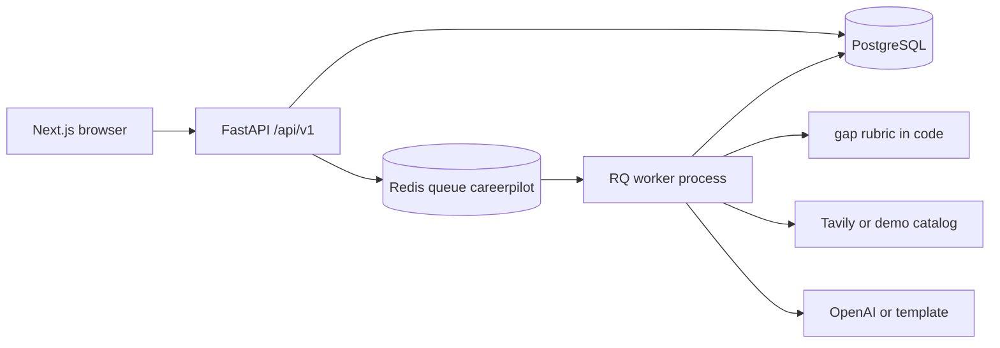
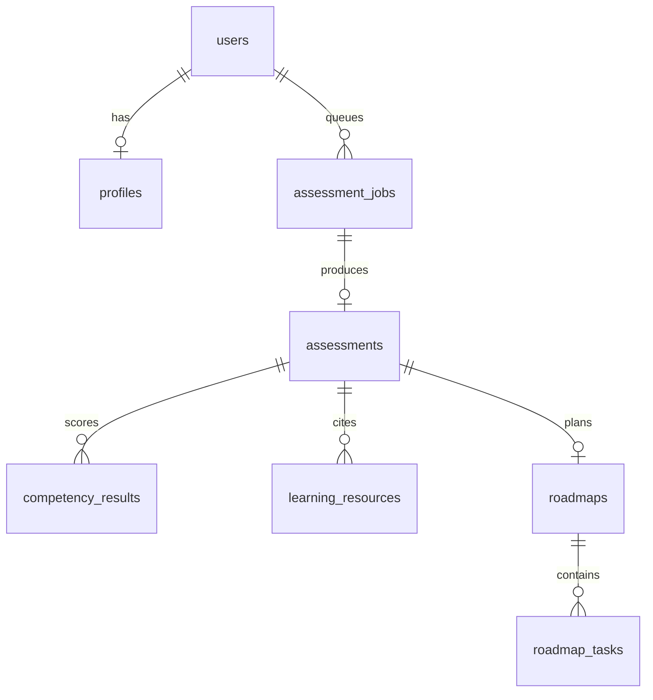

# CareerPilot AI

**Your career goal. A personalized roadmap. Measurable progress.**

CareerPilot AI is a career-learning product for students and fresh graduates. A person enters a target role and the skills they believe they already have. A background worker turns that profile into a scored skill-gap assessment, a set of real learning links, and a saved 4-, 8-, or 12-week roadmap. Progress on the dashboard is the share of roadmap tasks marked complete in PostgreSQL.

This repository is an interview MVP for Spektra Systems. It is not a hosted production service.

## Problem

Naming a job is not a study plan. Students can list “backend engineer” and still not know which skill to practice first, which documentation is worth opening, or whether last week’s work changed anything. A chat answer disappears, is not tied to the profile, and cannot be marked done.

CareerPilot keeps the profile, the rubric result, the links, and the tasks in one account.

## Key features

| Feature | What the product does |
| --- | --- |
| Account | Sign up and sign in. Passwords are hashed. Access tokens expire. |
| Profile | Education, experience level, self-reported skills (0–5), projects, target career, weekly hours, and a 4-, 8-, or 12-week timeline. |
| Assessment | A queued job normalizes the role, scores competencies, and explains what to learn first. |
| Skill gaps | Priority is `importance × gap`. Labels distinguish “not reported”, “below target”, and “meets target”. |
| Resources | Tavily when `TAVILY_API_KEY` is set. Otherwise a labelled demo catalog of real public URLs. |
| Roadmap | Weeks, objectives, tasks, estimated hours, outcomes, completion criteria, and the same resource URLs. |
| Progress | Task status and notes persist. The dashboard percentage is calculated from those rows. |

## Screenshots

Screenshot files are not committed. The landing page, signup form, and career profile were opened locally in a browser against the running API. A dev-only Next.js error badge was on screen during that pass because the first signup request used `http://127.0.0.1:3000` before that origin was added to CORS. Signup then returned `201` and the profile form rendered. Do not treat those captures as product screenshots.

## User journey

1. Open the app and create an account.
2. Complete the career profile, including the target role and self-reported skills.
3. Choose **Save and generate roadmap**.
4. The API inserts an `assessment_jobs` row and enqueues it on Redis.
5. A separate RQ worker scores gaps, discovers resources, and writes the assessment and roadmap.
6. The dashboard polls the job, then shows the career goal, gaps, next task, resources, and completion.
7. On the roadmap page, mark a task pending, in progress, or completed and add a note.
8. The dashboard percentage and “recently completed” list change from those database rows.

## Technology stack

| Layer | Choice |
| --- | --- |
| Frontend | Next.js 15 App Router, React 19, TypeScript, Tailwind CSS |
| API | Python 3.12, FastAPI, Pydantic, SQLAlchemy 2, Alembic |
| Database | PostgreSQL 16. Tests apply the same migration to SQLite. |
| Queue | Redis 7 and RQ. The worker is a separate process. |
| Auth | bcrypt password hashes and HS256 JWTs. Clerk is not integrated. |
| Narrative | OpenAI Chat Completions when `OPENAI_API_KEY` is set. Otherwise a template labelled `demo`. |
| Search | Tavily when `TAVILY_API_KEY` is set. Otherwise the demo catalog. |

## System architecture



The API process does not call the model or the search provider. It records the job and returns `202`. The worker owns the pipeline.

## Frontend

Pages live in `frontend/app` and share the landing-page type and color system: paper background, serif headlines, moss actions.

| Route | Role |
| --- | --- |
| `/` | Product introduction and the signup entry. |
| `/signup`, `/login` | Create a session. The access token is stored in `localStorage`. |
| `/onboarding` | Create or edit the career profile, then queue an assessment. |
| `/dashboard` | Goal, assessment summary, gap bars, next task, resources, completion, recent tasks. |
| `/roadmap` | Weeks, task details, notes, and status updates. |

`frontend/src/lib/api.ts` calls `NEXT_PUBLIC_API_URL` (default `http://localhost:8000`) and sends `Authorization: Bearer`. After a generate request, the job id is kept in `sessionStorage` and the dashboard polls `GET /api/v1/jobs/{id}` every two seconds.

Empty, loading, and error states are on the dashboard and roadmap. Unauthenticated visits to those pages go to `/login`.

## Backend

`backend/app/main.py` mounts the router in `backend/app/api.py` at `/api/v1`.

| Method | Path | Auth | Purpose |
| --- | --- | --- | --- |
| `GET` | `/health` | No | Process is up. |
| `GET` | `/health/ready` | No | Database ping, Redis ping, and which LLM and search modes are configured. |
| `POST` | `/auth/signup` | No | Create a user and return a token. |
| `POST` | `/auth/login` | No | Check the password and return a token. |
| `GET` | `/auth/me` | Yes | Current user. |
| `GET`, `PUT` | `/profile` | Yes | Read or save the career profile. |
| `POST` | `/assessments` | Yes | Insert a job and enqueue it. Returns `202`. |
| `GET` | `/jobs/{id}` | Yes | Job status for the owner. |
| `GET` | `/assessments/latest` | Yes | Latest assessment, competencies, and resources. |
| `GET` | `/roadmaps/current` | Yes | Latest roadmap and tasks. |
| `PATCH` | `/tasks/{id}` | Yes | Status and notes for a task the caller owns. |
| `GET` | `/dashboard` | Yes | Profile, assessment, roadmap, completion, next task, recent tasks, top gaps, resources. |

Settings are in `backend/app/config.py`. `postgres://` and `postgresql://` URLs are rewritten to `postgresql+psycopg2://`.

## Database design

Identifiers are UUID strings. Timestamps are timezone-aware. The migration is `backend/alembic/versions/0001_initial.py`.

| Table | What it stores |
| --- | --- |
| `users` | Email and password hash. |
| `profiles` | One row per user. Skills are JSON objects `{name, proficiency}`. |
| `assessment_jobs` | `queued`, `running`, `completed`, or `failed`, plus the RQ id, error, and result ids. |
| `assessments` | Normalized role, summary, learn-first reason, disclaimer, narrative provider, rubric version. |
| `competency_results` | One scored competency. Includes `user_id` so ownership does not require a join. |
| `learning_resources` | Title, URL, domain, snippet, skill, relevance, and provider (`tavily` or `demo`). |
| `roadmaps` | Title, timeline, weekly hours, overview, narrative provider. |
| `roadmap_tasks` | Week, objective, skills, hours, outcome, criteria, resource JSON, status, notes. Unique `(roadmap_id, sort_order)`. |

Completion is not a stored column. The API uses `round(completed_tasks * 100 / total_tasks)`.



## Authentication and authorization

There is no Clerk project in this tree. Signup stores a bcrypt hash. Login returns an HS256 JWT whose `sub` is the user id and whose `exp` comes from `JWT_EXPIRE_MINUTES` (default 7 days).

Protected handlers load the user from the bearer token. They never accept a user id from the browser. A job or task that belongs to someone else returns `404`. In `APP_ENV=production`, startup refuses the default JWT secret `dev-only-change-me`.

## AI career assessment

`app/pipeline.py` runs this sequence inside the worker:

`profile → normalize role → score gaps → discover resources → narrative → roadmap → PostgreSQL`

Role matching lives in `app/catalog.py`. Known targets include backend, frontend, full stack, data analyst, data scientist, machine learning, DevOps, and QA. An unrecognized target uses the software engineer rubric.

The optional model call may rewrite only `summary` and `learn_first_reason`. Scores and URLs are computed before that call. If the key is missing, the response is invalid, or the call fails, the template narrative is stored and `provider` is `demo`.

The assessment always stores this disclaimer: self-reported levels are what the user entered. They are not an objective measure of competence.

## Skill-gap calculation

Rubric version `importance-x-gap-v1`, implemented in `app/gaps.py`:

- `importance` is 1–5 for the role.
- `target_level` is a study target, not a certification.
- `self_reported_level` is copied from the profile. An unlisted skill is 0.
- `gap = max(0, target_level - self_reported_level)`
- `priority_score = importance * gap`
- `missing`: self-reported level is 0.
- `improve`: reported, but below the target.
- `sufficient`: reported at or above the target.

Aliases such as `postgres` map to SQL before scoring. A note on a skill cannot change the status. The recommendation text for an `improve` row says the comparison is not a verified score.

## Tavily resource discovery

`app/search.py` is separate from the LLM client. With `TAVILY_API_KEY`, the worker POSTs to `https://api.tavily.com/search` and keeps only `https` results. Each row stores title, URL, domain, a truncated snippet, the skill, and a relevance sentence written by the application.

Without a key, or when Tavily errors or returns nothing usable, the worker uses the predefined pages in `app/catalog.py`. Those rows use `provider=demo` and say they are not a live search result. The dashboard shows that label. URLs in the demo catalog are real public documentation and course pages. The model is not allowed to invent URLs. Roadmap tasks copy the URLs already stored on the assessment.

## Roadmap generation

`app/roadmap_builder.py` builds one study task and one practice task per week from the highest-priority gaps, the weekly hour budget, and the resources just retrieved. Task fields are week, objective, skills, title, details, estimated hours, expected outcome, completion criteria, and resource links. The roadmap row and its tasks are inserted in the same worker transaction as the assessment.

## Redis and RQ

`POST /api/v1/assessments` commits the job, then `app/queue.py` enqueues `app.worker.process_assessment_job` on the queue named `careerpilot`. If Redis is down, the job is marked `failed` and the API returns `503`.

Start the consumer as its own process:

```bash
python -m app.worker
```

On Linux the consumer is RQ’s forking `Worker`. On Windows, `os.fork` and `SIGALRM` do not exist, so the process uses `WindowsWorker` (`SimpleWorker` with the Unix timeout disabled). It is still a different process from the API. The queue name and job function are the same.

## Web search instead of RAG

The learning links a student needs are public and change: language docs, database manuals, course pages, and tutorials. A search request returns those URLs directly. The product does not have a private corpus to retrieve from, so a vector index would not answer the question.

RAG becomes useful later if the product must quote the user’s own notes, a syllabus, or a curated internal library. Until then, search results are attributed on each resource row, snippets are length-limited, and page text is wrapped as untrusted input. The narrative schema has no URL field, so a page cannot add a link by telling the model to do so.

## Project structure

```text
careerpilot-ai/
  frontend/app/                 Next.js routes
  frontend/src/lib/             API client and progress helper
  frontend/src/components/      Shared header
  backend/app/                  API, models, rubric, search, pipeline, worker
  backend/alembic/versions/     0001_initial
  backend/tests/                Auth, worker, gaps, schemas, demo search
  docs/                         Product, architecture, data, testing, decisions
  .github/workflows/ci.yml
  docker-compose.yml
  render.yaml
  .env.example
```

## Prerequisites

- Python 3.12
- Node.js 22 and npm
- Docker, with either `docker compose` or `docker-compose`
- No OpenAI or Tavily key is required to run the demo path

## Environment variables

Copy the example file and edit the secret before sharing a deployment.

```bash
cp .env.example .env
```

| Variable | Required | Purpose |
| --- | --- | --- |
| `APP_ENV` | No | `development` or `production`. Production refuses the default JWT secret. |
| `JWT_SECRET` | Yes in production | HMAC secret for access tokens. |
| `JWT_EXPIRE_MINUTES` | No | Token lifetime. Default `10080` (7 days). |
| `DATABASE_URL` | Yes | SQLAlchemy URL. Local default uses user, password, and database `careerpilot` on `localhost:5432`. |
| `REDIS_URL` | Yes for assessments | Default `redis://localhost:6379/0`. |
| `CORS_ORIGINS` | No | Comma-separated browser origins. Default includes `http://localhost:3000` and `http://127.0.0.1:3000`. |
| `OPENAI_API_KEY` | No | Empty selects the demo narrative. |
| `OPENAI_MODEL` | No | Default `gpt-4o-mini`. |
| `OPENAI_BASE_URL` | No | Default `https://api.openai.com/v1`. |
| `TAVILY_API_KEY` | No | Empty selects the demo resource catalog. |
| `NEXT_PUBLIC_API_URL` | No | Browser API origin. Default `http://localhost:8000`. |

Do not commit `.env` or `.env.local`.

## Local installation

From the repository root:

```bash
python -m venv backend/.venv
backend/.venv/bin/pip install -r backend/requirements.txt
npm install --prefix frontend
```

On Windows PowerShell, use `backend\.venv\Scripts\pip` and `backend\.venv\Scripts\python`.

## Docker Compose

From the repository root, start PostgreSQL and Redis:

```bash
docker compose up -d postgres redis
```

If the Docker CLI on your machine has no `compose` subcommand, use `docker-compose up -d postgres redis`. That is the command that worked on the Windows machine used to develop this tree.

The Compose file also defines `api` and `worker` services. Their database host is `postgres` and their Redis host is `redis`, which is correct only inside the Compose network. For the host-run commands below, keep `localhost` in `.env`.

To run the API and worker in containers as well:

```bash
docker compose up --build api worker
```

## Database migrations

With Postgres listening on `localhost:5432`:

```bash
cd backend
alembic upgrade head
```

On Windows:

```powershell
cd backend
.\.venv\Scripts\alembic upgrade head
```

## Start the backend

```bash
cd backend
uvicorn app.main:app --reload --port 8000
```

Windows:

```powershell
cd backend
.\.venv\Scripts\python -m uvicorn app.main:app --port 8000
```

Health: `GET http://localhost:8000/api/v1/health`

Readiness, including database, Redis, and which external modes are active: `GET http://localhost:8000/api/v1/health/ready`

## Start the worker

In a second terminal, from `backend`, with the same `DATABASE_URL` and `REDIS_URL`:

```bash
python -m app.worker
```

Windows:

```powershell
.\.venv\Scripts\python -m app.worker
```

Leave this process running. Assessment requests stay `queued` until it consumes them.

## Start the frontend

```bash
cd frontend
npm run dev
```

Open `http://localhost:3000`.

## Testing

Backend tests create a temporary SQLite file, run `alembic upgrade head`, and do not call OpenAI or Tavily. The worker test uses fakeredis.

```bash
cd backend
ruff check app tests alembic
pytest
```

Frontend:

```bash
cd frontend
npm run lint
npm run typecheck
npm test
npm run build
```

`npm test` runs Vitest on the completion helper. It checks that an empty task list is 0 percent and that a missing skill is labelled “Not reported”, not as a verified failure.

## CI

`.github/workflows/ci.yml` runs on push and pull request.

- Backend: Python 3.12, install `backend/requirements.txt`, Ruff, pytest.
- Frontend: Node 22, `npm ci`, lint, `tsc --noEmit`, Vitest, production build with `NEXT_PUBLIC_API_URL=http://localhost:8000`.

CI does not use paid API credentials or a Postgres service. The migration is executed against SQLite inside pytest.

## Deployment

This repository has not been deployed. Nothing here is a public URL.

A practical layout, using accounts you create yourself:

| Piece | Suggested host | Start command |
| --- | --- | --- |
| Frontend | Vercel | Set `NEXT_PUBLIC_API_URL` to the public API origin. |
| API | Render web service | `pip install -r requirements.txt && alembic upgrade head`, then `uvicorn app.main:app --host 0.0.0.0 --port $PORT`. See `render.yaml`. |
| Worker | Render background worker | `python -m app.worker`. |
| PostgreSQL | Neon or another Postgres | Put the SQLAlchemy URL in `DATABASE_URL`. |
| Redis | Upstash or another Redis | Put the URL in `REDIS_URL`. |

Also set `APP_ENV=production`, a long `JWT_SECRET`, and `CORS_ORIGINS` to the frontend origin. Point the host health check at `/api/v1/health`.

## Known limitations

- Clerk is not connected.
- Without `TAVILY_API_KEY`, resources are the demo catalog. They are real URLs and are labelled demo.
- Without a successful OpenAI call, the summary is template text labelled `demo`. Scores still come from the rubric.
- Skill levels are self-reported. The product does not test or certify ability.
- There is no resume parsing, interview practice, mentoring, calendar, or vector search.
- The Windows worker does not enforce RQ’s Unix job timeout.
- Screenshot files are not in the repository.
- Git history may be empty until you commit. This tree has not been pushed.

## Future improvements

- Run one live Tavily query and one live narrative with real keys and compare them with the demo path.
- Add email verification and refresh tokens.
- Add RAG only after there is a private corpus, such as notes or a syllabus.
- Deploy the four services and record the verified URLs in this README.

## Further reading

- `docs/PRD.md` — scope and non-goals
- `docs/ARCHITECTURE.md` — process boundaries
- `docs/AI_ENGINEERING_DECISIONS.md` — rubric, search, and untrusted pages
- `docs/DATA_MODEL.md` — tables and ownership
- `docs/TESTING_STRATEGY.md` — what the automated tests cover
- `docs/DECISION_LOG.md` — why this shape was chosen
