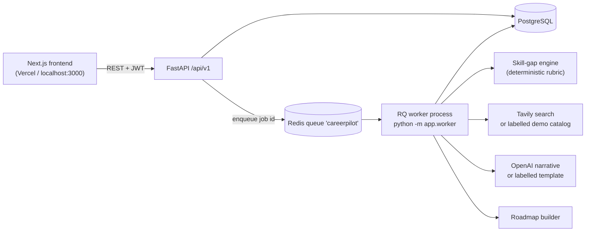
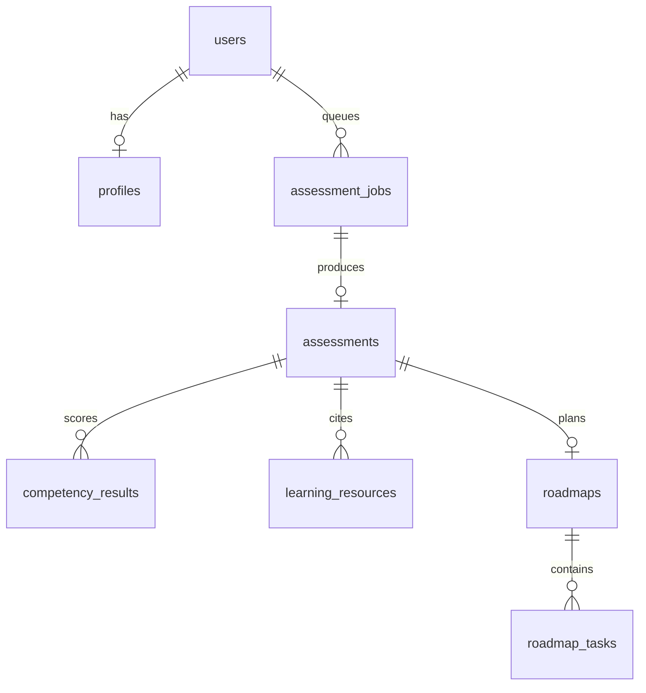

# CareerPilot AI

**Your career goal. A personalized roadmap. Measurable progress.**

> **Live demo:** _not deployed yet_ <!-- DEPLOYED_URL: after deploying, replace this line with: **Live demo:** https://YOUR-VERCEL-APP.vercel.app (API: https://YOUR-RENDER-API.onrender.com/api/v1/health) -->

CareerPilot AI is an AI-powered career guidance and learning-roadmap platform for students and fresh graduates. A user enters a target career, current skills with self-reported proficiency, education, experience, and weekly availability. A **separate background worker** scores the skill gaps with a deterministic rubric, finds learning resources (Tavily live search, or a clearly labelled demo catalog), writes an AI-assisted explanation (OpenAI, or a labelled template), and saves a 4-, 8-, or 12-week roadmap. Progress is tracked per task in PostgreSQL.

It is an independent project. It does not share code with RuFlow or MedResearch.

## Interview requirements → where they are met

| Requirement | Where |
| --- | --- |
| Free choice of problem (AI Career Coach) | Whole product; see `docs/PRD.md` |
| New project, fresh public repo | Standalone repo; you create the GitHub remote (see [GitHub and deployment](#github-and-deployment)) |
| Frontend | Next.js 15 / React 19 / TypeScript / Tailwind in `frontend/` |
| API | FastAPI in `backend/app/api.py`, mounted at `/api/v1` |
| Database | PostgreSQL, SQLAlchemy models, Alembic migration `0001_initial` |
| Background worker / queue | Redis + RQ, run as its own process: `python -m app.worker` |
| AI component | Deterministic gap scoring + OpenAI narrative + Tavily discovery (`app/gaps.py`, `app/ai.py`, `app/search.py`) |
| Authentication | bcrypt + JWT; every user-specific route is protected and owner-scoped |
| Built with AI coding agents | Agent notes in `CLAUDE.md` / `AGENTS.md`; decisions in `docs/` |
| Specification and planning docs in the repo | `docs/PRD.md`, `ARCHITECTURE.md`, `IMPLEMENTATION_PLAN.md`, `AI_ENGINEERING_DECISIONS.md`, `DATA_MODEL.md`, `DECISION_LOG.md`, `TESTING_STRATEGY.md` |
| Tests, CI, deployed link | Pytest + Vitest, `.github/workflows/ci.yml`; deployed link goes at the marker at the top of this file |
| README explains architecture and decisions | This file, plus `docs/` |

## Problem

Naming a job is not a study plan. A student can say "backend engineer" and still not know which skill to practise first, which material is worth opening, or whether last week's work moved them forward. A chat answer disappears, is not tied to a profile, and cannot be ticked off. CareerPilot keeps the profile, the rubric result, the links, and the tasks in one account.

## Features

| Feature | What it does |
| --- | --- |
| Account | Sign up and sign in. bcrypt-hashed passwords, expiring JWTs. |
| Career profile | Name, education, experience level, skills with 0–5 self-reported proficiency, projects, target career, weekly hours, 4/8/12-week duration. |
| Assessment | Queued job. Normalizes the role, scores every competency, explains what to learn first. |
| Skill gaps | `priority = importance × gap`. Labels: not reported / below target / meets target. |
| Resources | Tavily when `TAVILY_API_KEY` is set. Otherwise a labelled demo catalog of real public URLs. URLs are never invented. |
| Roadmap | Weekly objectives, tasks, estimated hours, expected outcomes, completion criteria, resource links. |
| Progress | Mark tasks pending / in progress / completed and keep notes. Survives refresh. The dashboard reads the same rows. |
| Resilience | Job states `queued → running → completed / failed` with clear UI messages, a retry button, and a hint when the worker is not running. |

## Screenshots

No screenshot files are committed. After you run the app, add captures to `docs/screenshots/` and reference them here.

## Technology stack

| Layer | Technology |
| --- | --- |
| Frontend | Next.js 15 (App Router, single tree in `frontend/src/app`), React 19, TypeScript, Tailwind CSS |
| API | Python 3.12, FastAPI, Pydantic v2 |
| Database | PostgreSQL 16, SQLAlchemy 2, Alembic |
| Queue | Redis 7, RQ (separate worker process; Windows-compatible worker class) |
| AI | OpenAI Chat Completions (optional, narrative only) |
| Resource discovery | Tavily Search API (optional) with labelled fallback catalog |
| Auth | bcrypt, PyJWT (HS256) |
| Tests | Pytest (+ fakeredis, SQLite-backed migration), Vitest |
| CI | GitHub Actions |
| Local services | Docker Compose (PostgreSQL, Redis; optional API + worker) |

## Architecture



The API never calls the model or the search provider. It records a job row, enqueues its id, and returns `202`. The worker owns the pipeline: `profile → normalize role → score gaps → discover resources → narrative → roadmap → PostgreSQL`.

### Components

- **Frontend** (`frontend/src`): routes `/`, `/signup`, `/login`, `/onboarding`, `/dashboard`, `/roadmap`. `src/lib/api.ts` is the only HTTP client; it turns non-JSON, 422, 5xx, and network failures into readable messages and sends the user to `/login` when a token expires.
- **API** (`backend/app`): `api.py` routes, `security.py` bcrypt/JWT, `schemas.py` validation, `models.py` ORM, `main.py` CORS + error handling + health checks.
- **Worker** (`app/worker.py`, `app/queue.py`, `app/pipeline.py`): consumes `app.worker.process_assessment_job`, writes the assessment and roadmap in one transaction, sets the job to `completed` or `failed` with an error message.
- **Database**: PostgreSQL, schema in `backend/alembic/versions/0001_initial.py`.

## Main user journey

1. Landing page → **Create an account**.
2. Signup validates the email and password, stores a bcrypt hash, returns a JWT; the frontend stores it and goes to onboarding.
3. Onboarding saves the career profile (`PUT /profile`) and queues the assessment (`POST /assessments`, `202`).
4. The RQ worker scores gaps, discovers resources, writes the narrative and roadmap, and marks the job `completed`.
5. The dashboard polls until the job finishes, then shows the goal, assessment summary, gaps, resources, completion, next task, and recently completed tasks.
6. The roadmap page lists weekly plans; tasks can be marked pending / in progress / completed and annotated. Refreshing keeps everything.

## Backend API overview

| Method | Path | Auth | Purpose |
| --- | --- | --- | --- |
| `GET` | `/api/v1/health` | No | Process is up |
| `GET` | `/api/v1/health/ready` | No | Database, migrations applied, Redis, and active LLM/search modes |
| `POST` | `/api/v1/auth/signup` | No | Create user, return token (`409` if the email exists, `422` on invalid input) |
| `POST` | `/api/v1/auth/login` | No | Return token (`401` on bad credentials) |
| `GET` | `/api/v1/auth/me` | Yes | Current user |
| `GET` / `PUT` | `/api/v1/profile` | Yes | Read / save the career profile |
| `POST` | `/api/v1/assessments` | Yes | Create a job and enqueue it (`202`; `503` if Redis is down) |
| `GET` | `/api/v1/jobs/{id}` | Yes | Job status (owner only) |
| `GET` | `/api/v1/assessments/latest` | Yes | Latest assessment, competencies, resources |
| `GET` | `/api/v1/roadmaps/current` | Yes | Latest roadmap and tasks |
| `PATCH` | `/api/v1/tasks/{id}` | Yes | Update status and notes (owner only) |
| `GET` | `/api/v1/dashboard` | Yes | Everything the dashboard needs, including `latest_job` |

Interactive docs: `http://localhost:8000/docs`.

## Database design

Full column-level description in `docs/DATA_MODEL.md`.



Completion percentage is not stored; it is computed from task rows (`round(completed × 100 / total)`).

## Authentication and authorization

- Passwords: bcrypt. Because bcrypt only reads 72 bytes, signup rejects passwords longer than **72 bytes in UTF-8** instead of silently truncating them (the frontend and API both check bytes, not characters).
- Email: validated with `email-validator` (syntax only) and lower-cased; a unique index guarantees one account per address. Concurrent duplicate signups are resolved by the index and return `409`.
- Tokens: HS256 JWT with `sub = user id` and an expiry (`JWT_EXPIRE_MINUTES`). The frontend keeps it in `localStorage` and clears it on a `401`.
- Authorization: every handler derives the user from the token and filters by `user_id`. Another user's job or task returns `404`.
- Production: the API refuses to start with the default JWT secret when `APP_ENV=production`.

## AI integration and decision-making

- **Scores are deterministic.** `app/gaps.py` (rubric `importance-x-gap-v1`): `gap = max(0, target − self_reported)`, `priority = importance × gap`; `missing` = level 0, `improve` = below target, `sufficient` = at/above target. An LLM never produces or alters a number.
- **AI writes prose only.** With `OPENAI_API_KEY`, the model rewrites `summary` and `learn_first_reason` from structured facts. Its output schema has no URL or score fields. On any failure the template narrative is stored and labelled `demo`.
- **Tavily finds resources.** With `TAVILY_API_KEY`, results (https only) are stored with provider `tavily`. Otherwise (or if Tavily fails) the predefined catalog is used, stored as `demo`, and the UI says "Demo catalog, not live search".
- **Untrusted web text.** Snippets are truncated and wrapped in `<untrusted_page>` tags in the prompt, with an instruction to treat them as data.
- **No RAG.** There is no private corpus; learning links are a public-web search problem.

More detail: `docs/AI_ENGINEERING_DECISIONS.md`.

## Background worker and Redis queue

`POST /assessments` inserts an `assessment_jobs` row (`queued`), enqueues `app.worker.process_assessment_job` on queue `careerpilot`, and returns. The worker marks the job `running`, runs the pipeline, then `completed` (with `assessment_id` and `roadmap_id`) or `failed` (with an error). If Redis is unreachable the API marks the job `failed` and returns `503`.

On Linux/macOS the worker is RQ's forking `Worker`. On Windows (no `fork`, no `SIGALRM`) it uses `WindowsWorker`, a `SimpleWorker` without the Unix timeout. It is still a separate process from the API.

## Local installation

Prerequisites: Python 3.12, Node.js 22 + npm, Docker Desktop. No OpenAI or Tavily key is needed for the demo path.

### Windows PowerShell (recommended)

```powershell
# from the extracted project folder (the one containing docker-compose.yml)
.\scripts\setup.ps1     # creates .env files, starts Postgres + Redis, venv, pip, migrations, npm ci
.\scripts\dev.ps1       # opens API, worker, and frontend in three windows
.\scripts\verify.ps1    # health checks + end-to-end smoke journey
```

If PowerShell blocks scripts: `powershell -ExecutionPolicy Bypass -File .\scripts\setup.ps1`.

Manual equivalent:

```powershell
Copy-Item .env.example .env
Copy-Item frontend\.env.example frontend\.env.local
docker compose up -d --wait postgres redis

cd backend
python -m venv .venv
.\.venv\Scripts\python -m pip install -r requirements.txt
.\.venv\Scripts\python -m alembic upgrade head
.\.venv\Scripts\python -m uvicorn app.main:app --reload --port 8000     # terminal 1

.\.venv\Scripts\python -m app.worker                                    # terminal 2 (same backend folder)

cd ..\frontend
npm ci
npm run dev                                                             # terminal 3
```

### Bash (macOS / Linux / Git Bash)

```bash
bash scripts/setup.sh
cd backend && source .venv/bin/activate        # Git Bash: source .venv/Scripts/activate
uvicorn app.main:app --reload --port 8000      # terminal 1
python -m app.worker                           # terminal 2
cd frontend && npm run dev                     # terminal 3
bash scripts/verify.sh
```

Open <http://localhost:3000>. If your Docker has no `compose` subcommand, use `docker-compose`.

### Health checks

```powershell
Invoke-RestMethod http://localhost:8000/api/v1/health
Invoke-RestMethod http://localhost:8000/api/v1/health/ready
```

`/health/ready` should report `database`, `migrations`, and `redis` as `true`. If signup shows a database error, `migrations` is usually `false`: run `alembic upgrade head` in `backend/`.

## Docker

```bash
docker compose up -d                       # PostgreSQL + Redis only (default; run API/worker/web locally)
docker compose --profile app up --build    # additionally build and run migrations + API (:8000) + worker
```

Inside Compose the API/worker use the hostnames `postgres` and `redis`. For host-run commands keep `localhost` in `.env`. Stop everything with `docker compose down` (add `-v` to delete the database volume). Do not run the host API and the containerised API at the same time; both use port 8000.

## Environment variables

Copy `.env.example` to `.env` (project root; read by the API, worker, and Alembic) and `frontend/.env.example` to `frontend/.env.local`. Never commit them.

| Variable | Used by | Required | Purpose |
| --- | --- | --- | --- |
| `APP_ENV` | API, worker | No | `development` (default) or `production`; production refuses the default JWT secret and disables the any-localhost-port CORS rule |
| `JWT_SECRET` | API | Production | HMAC secret for tokens. Generate: `python -c "import secrets; print(secrets.token_urlsafe(48))"` |
| `JWT_EXPIRE_MINUTES` | API | No | Default `10080` |
| `DATABASE_URL` | API, worker, Alembic | Yes | `postgres://` and `postgresql://` are rewritten to `postgresql+psycopg2://` |
| `REDIS_URL` | API, worker | Yes | Default `redis://localhost:6379/0` |
| `CORS_ORIGINS` | API | Production | Comma-separated origins, no trailing slash, e.g. your Vercel URL |
| `OPENAI_API_KEY` | worker | No | Empty → demo narrative |
| `OPENAI_MODEL`, `OPENAI_BASE_URL` | worker | No | Defaults `gpt-4o-mini`, `https://api.openai.com/v1` |
| `TAVILY_API_KEY` | worker | No | Empty → demo resource catalog |
| `NEXT_PUBLIC_API_URL` | frontend | Yes in deployment | Public API origin; default `http://localhost:8000`. Baked in at build time |

## Testing

```powershell
cd backend
.\.venv\Scripts\python -m ruff check app tests
.\.venv\Scripts\python -m pytest -q

cd ..\frontend
npm run lint
npm run typecheck
npm test
npm run build
```

Backend tests use a temporary SQLite file, apply the Alembic migration, use fakeredis and the in-process RQ worker, and never call OpenAI or Tavily. They cover signup/login, email normalization, duplicate and concurrent-duplicate signup, password length limits, token expiry, protected routes, profile saving, assessment job creation, worker execution, persistence, ownership checks, task updates, and the gap rubric. Vitest covers the progress helpers, API error formatting, and form validation. `scripts/smoke_journey.py` (via `verify.ps1`/`verify.sh`) runs the full signup → queue → worker → complete task flow against your real Postgres and Redis.

## CI

`.github/workflows/ci.yml` runs on every push and pull request:

- **backend**: Python 3.12, `pip install -r requirements.txt`, `ruff check app tests`, `python -m pytest -q`
- **frontend**: Node 22, `npm ci`, `npm run lint`, `npm run typecheck`, `npm test`, `npm run build`
- **compose**: `docker compose --profile app config --quiet`

No paid API keys or database services are required.

## Deployment

Nothing is deployed from this repository; you do it with your own accounts. Provision PostgreSQL and Redis first, then:

| Piece | Host | Settings |
| --- | --- | --- |
| API | Render web service (see `render.yaml`) | root `backend`; build `pip install -r requirements.txt && alembic upgrade head`; start `uvicorn app.main:app --host 0.0.0.0 --port $PORT`; health check `/api/v1/health` |
| Worker | Render background worker | root `backend`; build `pip install -r requirements.txt`; start `python -m app.worker` |
| Frontend | Vercel | root directory `frontend`; env `NEXT_PUBLIC_API_URL=https://<your-api>.onrender.com` |
| PostgreSQL | Render Postgres / Neon / Supabase | set `DATABASE_URL` on API **and** worker |
| Redis | Render Key Value / Upstash | set `REDIS_URL` on API **and** worker (Upstash: use the `rediss://` URL) |

API and worker environment: `APP_ENV=production`, `JWT_SECRET` (long random; same on both), `DATABASE_URL`, `REDIS_URL`, optional `OPENAI_API_KEY` / `TAVILY_API_KEY`. API only: `CORS_ORIGINS=https://<your-app>.vercel.app`. After deploying, check `https://<api>/api/v1/health/ready`, then replace the marker at the top of this README with the real URL.

## GitHub and deployment

```powershell
git remote add origin https://github.com/<you>/careerpilot-ai.git
git branch -M main
git push -u origin main
```

Create the empty public repository on GitHub first (no README/license, so the push is a plain fast-forward). Then import the repo into Vercel (root `frontend`) and Render (Blueprint from `render.yaml`).

## Key engineering decisions

| Decision | Why |
| --- | --- |
| Separate worker process | Scoring, search, and LLM calls are slow and can fail; the API stays fast and returns `202`. |
| Redis + RQ | A small, readable queue that fits one job type; no broker or orchestration framework needed. |
| Deterministic skill-gap scoring | Numbers must be reproducible, testable, and explainable. A model must not invent them. |
| AI-generated narrative only | Prose is where a model adds value; its schema cannot add scores or links. |
| Tavily discovery | Learning links are public and change; search returns real URLs with attribution. |
| Labelled fallback catalog | The product works with no keys, and the UI never presents demo data as live. |
| JWT + bcrypt | Simple, stateless, testable; no third-party auth dependency for an MVP. |
| PostgreSQL | Relational ownership (`user_id` everywhere), constraints, and migrations. |
| Single App Router tree | `frontend/src/app` only; duplicate trees silently shadow each other in Next.js. |

## Current limitations

- Skill levels are self-reported; nothing is verified or certified.
- Without keys, resources are a fixed catalog and the narrative is a template (both labelled `demo`).
- Role rubrics cover a fixed set of careers; unknown roles use the software-engineer rubric.
- The token is stored in `localStorage` (acceptable for an MVP; httpOnly cookies would be stronger).
- No email verification, password reset, or refresh tokens.
- The Windows worker does not enforce RQ's job timeout.
- Not deployed; no screenshots are committed.

## Documentation

`docs/PRD.md` · `docs/ARCHITECTURE.md` · `docs/IMPLEMENTATION_PLAN.md` · `docs/AI_ENGINEERING_DECISIONS.md` · `docs/DATA_MODEL.md` · `docs/DECISION_LOG.md` · `docs/TESTING_STRATEGY.md`
