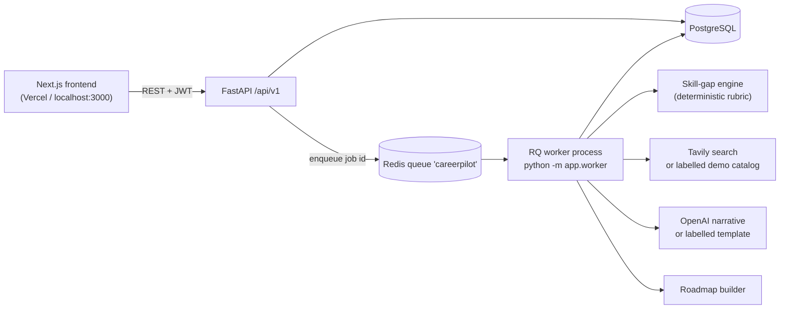
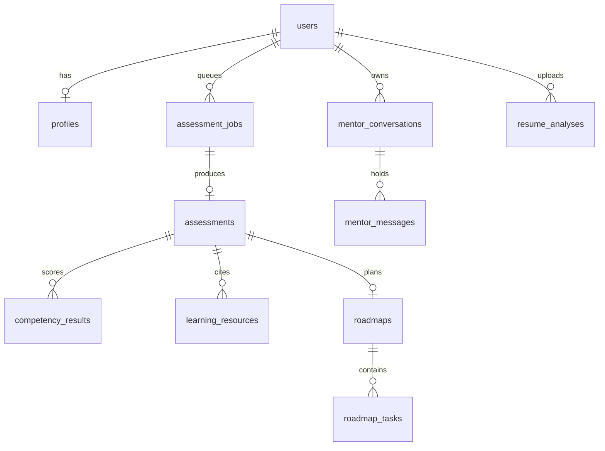

# CareerPilot AI 2.0

**Your career goal. A personalized roadmap. Measurable progress.**

> **Live demo:** _not deployed yet_ <!-- DEPLOYED_URL: after deploying, replace this line with: **Live demo:** https://YOUR-VERCEL-APP.vercel.app (API: https://YOUR-RENDER-API.onrender.com/api/v1/health) -->

CareerPilot AI 2.0 is an **AI career intelligence and execution platform** for students and fresh graduates. It has three layers:

1. **Understand**: a career profile plus an uploaded resume (PDF/DOCX). The resume analysis separates skills *demonstrated by project or experience evidence* from skills *merely listed* and skills *inferred with low confidence*, and checks every evidence quote against the real resume text.
2. **Reason and plan**: a deterministic rubric scores skill gaps (priority = importance × gap). OpenAI then writes a personalized 4/8/12-week roadmap from those scores, the learner's hours, and verified resources. The output is validated against a strict schema; if it fails, a deterministic builder is used and the roadmap is labelled `fallback`.
3. **Guide and adapt**: a context-aware **AI Career Mentor** with persistent conversations, and an explicit **adapt plan** action that re-plans only the unstarted tasks from actual progress (completed work is kept).

Everything AI-generated is labelled with its real provider (`openai` or `demo`). With no keys set, every feature still works through deterministic fallbacks and says so in the UI.

It is an independent project. It does not share code with RuFlow or MedResearch.

## Interview requirements → where they are met

| Requirement | Where |
| --- | --- |
| Free choice of problem (AI Career Coach) | Whole product; see `docs/PRD.md` |
| New project, fresh public repo | Standalone repo; you create the GitHub remote (see [GitHub and deployment](#github-and-deployment)) |
| Frontend | Next.js 15 / React 19 / TypeScript / Tailwind in `frontend/` |
| API | FastAPI in `backend/app/api.py`, mounted at `/api/v1` |
| Database | PostgreSQL, SQLAlchemy models, Alembic migration `0001_initial` |
| Background worker / queue | Redis + RQ, run as its own process: `python -m app.worker` |
| AI component | Deterministic gap scoring + OpenAI narrative + Tavily discovery (`app/gaps.py`, `app/ai.py`, `app/search.py`) |
| Authentication | bcrypt + JWT; every user-specific route is protected and owner-scoped |
| Built with AI coding agents | Agent notes in `CLAUDE.md` / `AGENTS.md`; decisions in `docs/` |
| Specification and planning docs in the repo | `docs/PRD.md`, `ARCHITECTURE.md`, `IMPLEMENTATION_PLAN.md`, `AI_ENGINEERING_DECISIONS.md`, `DATA_MODEL.md`, `DECISION_LOG.md`, `TESTING_STRATEGY.md` |
| Tests, CI, deployed link | Pytest + Vitest, `.github/workflows/ci.yml`; deployed link goes at the marker at the top of this file |
| README explains architecture and decisions | This file, plus `docs/` |

## Problem

Naming a job is not a study plan. A student can say "backend engineer" and still not know which skill to practise first, which material is worth opening, or whether last week's work moved them forward. A chat answer disappears, is not tied to a profile, and cannot be ticked off. CareerPilot keeps the profile, the rubric result, the links, and the tasks in one account.

## Features

| Feature | What it does |
| --- | --- |
| Account | Sign up and sign in. bcrypt-hashed passwords, expiring JWTs. |
| Career profile | Name, education, experience level, skills with 0–5 self-reported proficiency, projects, target career, weekly hours, 4/8/12-week duration. |
| Assessment | Queued job. Normalizes the role, scores every competency, explains what to learn first. |
| Skill gaps | `priority = importance × gap`. Labels: not reported / below target / meets target. |
| Resources | Tavily when `TAVILY_API_KEY` is set. Otherwise a labelled demo catalog of real public URLs. URLs are never invented. |
| Roadmap | Weekly objectives, tasks, estimated hours, expected outcomes, completion criteria, resource links. |
| Progress | Mark tasks pending / in progress / completed and keep notes. Survives refresh. The dashboard reads the same rows. |
| AI Career Mentor (`/mentor`) | Persistent conversations. Each answer gets a compact context of *your* profile, top gaps, roadmap progress, delayed tasks and resume evidence, plus the last 8 messages. Live OpenAI or a clearly labelled template. |
| AI roadmap | OpenAI writes weekly objectives, milestones, project-based tasks with measurable completion criteria; validated; falls back to the deterministic builder. |
| Adaptive plan | Explicit actions: revise, more intensive, lighter, focus on one skill. Completed and in-progress tasks are preserved. |
| Resume Analyzer (`/resume-analyzer`) | PDF/DOCX upload (5 MB), evidence-based skill classification, deterministic target-role comparison, apply skills to profile. |
| Dashboard | Real metrics only: progress, skills identified, critical gaps, milestones, streak (from persisted completion timestamps), 14-day activity, readiness, next action. |
| Resilience | Job states `queued → running → completed / failed` with clear UI messages, a retry button, and a hint when the worker is not running. |

## Screenshots

No screenshot files are committed. After you run the app, add captures to `docs/screenshots/` and reference them here.

## Technology stack

| Layer | Technology |
| --- | --- |
| Frontend | Next.js 15 (App Router, single tree in `frontend/src/app`; authenticated pages in the `(app)` route group with a sidebar shell), React 19, TypeScript, Tailwind CSS (dark design system, no component library) |
| API | Python 3.12, FastAPI, Pydantic v2 |
| Database | PostgreSQL 16, SQLAlchemy 2, Alembic |
| Queue | Redis 7, RQ (separate worker process; Windows-compatible worker class) |
| AI | OpenAI Chat Completions via one small client (`app/llm.py`) with timeouts: mentor, roadmap, resume analysis, assessment narrative (all optional) |
| Resource discovery | Tavily Search API (optional) with labelled fallback catalog |
| Auth | bcrypt, PyJWT (HS256) |
| Resume parsing | `pypdf` (PDF), stdlib `zipfile` (DOCX); files are never stored |
| Tests | Pytest (+ fakeredis, SQLite-backed migration), Vitest |
| CI | GitHub Actions |
| Local services | Docker Compose (PostgreSQL, Redis; optional API + worker) |

## Architecture



The API never calls the model or the search provider. It records a job row, enqueues its id, and returns `202`. The worker owns the pipeline: `profile → normalize role → score gaps → discover resources → narrative → roadmap → PostgreSQL`.

### Components

- **Frontend** (`frontend/src`): routes `/`, `/signup`, `/login`, `/onboarding`, `/dashboard`, `/roadmap`. `src/lib/api.ts` is the only HTTP client; it turns non-JSON, 422, 5xx, and network failures into readable messages and sends the user to `/login` when a token expires.
- **API** (`backend/app`): `api.py` routes, `security.py` bcrypt/JWT, `schemas.py` validation, `models.py` ORM, `main.py` CORS + error handling + health checks.
- **Worker** (`app/worker.py`, `app/queue.py`, `app/pipeline.py`): consumes `app.worker.process_assessment_job`, writes the assessment and roadmap in one transaction, sets the job to `completed` or `failed` with an error message.
- **Database**: PostgreSQL, schema in `backend/alembic/versions/0001_initial.py`.

## Main user journey

1. Landing page → **Create an account**.
2. Signup validates the email and password, stores a bcrypt hash, returns a JWT; the frontend stores it and goes to onboarding.
3. Onboarding saves the career profile (`PUT /profile`) and queues the assessment (`POST /assessments`, `202`).
4. The RQ worker scores gaps, discovers resources, writes the narrative and roadmap, and marks the job `completed`.
5. The dashboard polls until the job finishes, then shows the goal, assessment summary, gaps, resources, completion, next task, and recently completed tasks.
6. The roadmap page lists weekly plans; tasks can be marked pending / in progress / completed and annotated. Refreshing keeps everything.

## Backend API overview

| Method | Path | Auth | Purpose |
| --- | --- | --- | --- |
| `GET` | `/api/v1/health` | No | Process is up |
| `GET` | `/api/v1/health/ready` | No | Database, migrations applied, Redis, and active LLM/search modes |
| `POST` | `/api/v1/auth/signup` | No | Create user, return token (`409` if the email exists, `422` on invalid input) |
| `POST` | `/api/v1/auth/login` | No | Return token (`401` on bad credentials) |
| `GET` | `/api/v1/auth/me` | Yes | Current user |
| `GET` / `PUT` | `/api/v1/profile` | Yes | Read / save the career profile |
| `POST` | `/api/v1/assessments` | Yes | Create a job and enqueue it (`202`; `503` if Redis is down) |
| `GET` | `/api/v1/jobs/{id}` | Yes | Job status (owner only) |
| `GET` | `/api/v1/assessments/latest` | Yes | Latest assessment, competencies, resources |
| `GET` | `/api/v1/roadmaps/current` | Yes | Latest roadmap and tasks |
| `PATCH` | `/api/v1/tasks/{id}` | Yes | Update status and notes (owner only) |
| `POST` | `/api/v1/roadmaps/current/adapt` | Yes | Queue a plan revision (`mode`: revise, intensive, lighter, focus + `focus_skill`) |
| `GET` | `/api/v1/dashboard` | Yes | Metrics, charts data, `latest_job`, resume summary |
| `GET` | `/api/v1/mentor/status` | Yes | Live vs demo mode and which context exists |
| `POST` / `GET` | `/api/v1/mentor/conversations` | Yes | Create / list your conversations |
| `GET` / `DELETE` | `/api/v1/mentor/conversations/{id}` | Yes | Read / delete (owner only, else `404`) |
| `POST` | `/api/v1/mentor/conversations/{id}/messages` | Yes | Ask the mentor; returns the saved user and assistant messages |
| `POST` | `/api/v1/resume/analyze` | Yes | Multipart upload (`file`); validates, extracts text, queues the analysis (`202`) |
| `GET` | `/api/v1/resume/latest` | Yes | Latest analysis and role comparison |
| `POST` | `/api/v1/resume/{id}/apply-to-profile` | Yes | Add detected skills to the profile (conservative levels, never overwrites) |
| `DELETE` | `/api/v1/resume/{id}` | Yes | Delete an analysis |

Interactive docs: `http://localhost:8000/docs`.

## Database design

Full column-level description in `docs/DATA_MODEL.md`.



`assessment_jobs.kind` (`assessment`, `adapt`, `resume`) lets one queue and one worker serve all expensive operations. `roadmaps` records `source` (`ai`/`fallback`), milestones and the adaptation history; `resume_analyses.source_text` holds extracted text only until the worker finishes and is then cleared.

Completion percentage is not stored; it is computed from task rows (`round(completed × 100 / total)`).

## Authentication and authorization

- Passwords: bcrypt. Because bcrypt only reads 72 bytes, signup rejects passwords longer than **72 bytes in UTF-8** instead of silently truncating them (the frontend and API both check bytes, not characters).
- Email: validated with `email-validator` (syntax only) and lower-cased; a unique index guarantees one account per address. Concurrent duplicate signups are resolved by the index and return `409`.
- Tokens: HS256 JWT with `sub = user id` and an expiry (`JWT_EXPIRE_MINUTES`). The frontend keeps it in `localStorage` and clears it on a `401`.
- Authorization: every handler derives the user from the token and filters by `user_id`. Another user's job or task returns `404`.
- Production: the API refuses to start with the default JWT secret when `APP_ENV=production`.

## AI integration and decision-making (assessment)

- **Scores are deterministic.** `app/gaps.py` (rubric `importance-x-gap-v1`): `gap = max(0, target − self_reported)`, `priority = importance × gap`; `missing` = level 0, `improve` = below target, `sufficient` = at/above target. An LLM never produces or alters a number.
- **AI writes prose only.** With `OPENAI_API_KEY`, the model rewrites `summary` and `learn_first_reason` from structured facts. Its output schema has no URL or score fields. On any failure the template narrative is stored and labelled `demo`.
- **Tavily finds resources.** With `TAVILY_API_KEY`, results (https only) are stored with provider `tavily`. Otherwise (or if Tavily fails) the predefined catalog is used, stored as `demo`, and the UI says "Demo catalog, not live search".
- **Untrusted web text.** Snippets are truncated and wrapped in `<untrusted_page>` tags in the prompt, with an instruction to treat them as data.
- **No RAG.** There is no private corpus; learning links are a public-web search problem.

More detail: `docs/AI_ENGINEERING_DECISIONS.md`.

## AI capabilities and deterministic boundaries

| Responsibility | Done by |
| --- | --- |
| Competency importance, targets, self-reported levels, priority scores, gap status, readiness and resume match numbers, streaks, authorization, validation | **Python** (deterministic, tested) |
| Assessment narrative, roadmap text (objectives, tasks, criteria, milestones), resume skill/evidence extraction, mentor answers | **OpenAI** (optional), validated before use |
| Learning links | **Tavily** or the verified demo catalog. Model-supplied URLs not in that list are discarded |

**AI Career Mentor.** `app/mentor.py` builds a compact, user-scoped context (every query filtered by `user.id`): profile and self-reported skills, top gaps, rubric coverage, roadmap progress, next tasks, skipped tasks, resume evidence. It is injected inside `<user_context>` tags with rules to treat it as data, to never claim verified skills, and to point to the app when data is missing. History is bounded to 8 messages. Messages are stored in PostgreSQL with the provider that produced them. If the key is missing or the call fails, a template answer built from the same context is returned, ends with an explicit "Demo mode" note, and is stored with `provider = demo`. Replies are not streamed; the UI shows a typing indicator.

**AI roadmap and adaptation.** `app/roadmap_ai.py` sends the deterministic gaps, hour budget, week range, verified resources, resume evidence and (when adapting) progress to the model, then validates: exact week numbers, per-week hours within 50-125% of the budget, only known skills, no vague titles, resource URLs limited to the provided list. Any failure falls back to `build_tasks`. `app/adaptive.py` adds progress evidence (every 6 completed hours on a skill raise its *planning* level by one, capped at the target) to re-rank focus skills; the stored assessment is never modified. Adapting deletes only `pending` tasks and keeps `completed` and `in_progress` ones.

**Resume intelligence.** Upload checks: extension, content type, magic bytes (`%PDF-`, `PK`), 5 MB, PDF page cap, encrypted/corrupt/empty/scanned documents rejected with clear messages; DOCX is read with regexes (no XML parser, zip-bomb size check). Resume text is untrusted: it is wrapped in `<resume>` tags and the prompt says to ignore instructions inside it. The model proposes a level and a quote per skill; `app/evidence.py` then verifies each one independently, using only the resume text: the quote must exist (after whitespace and quote-mark normalization) as one bullet/passage; it must name *that* skill (or a true synonym such as Postgres/PostgreSQL), so a quote about something else, or one generic quote reused for several technologies, is rejected; and for `demonstrated` the clause naming the skill must describe doing something with it (built, deployed, tested, ...), must not be a weak claim ("familiar with"), and must not be a skills list. Failures are downgraded: demonstrated → listed (named in the resume) → inferred (not named). Inferred skills carry no evidence and never raise the match number. The role match is `sum(importance × points) / sum(importance)` with demonstrated = 1, listed = 0.5, otherwise 0; it is labelled "evidence coverage", not a hiring score. Without a key (or if the model fails or returns invalid data) a conservative keyword analysis runs, goes through the same verifier, and is labelled demo: skill-list mentions and vague mentions stay "listed", and only a clause that describes real use can reach "demonstrated".

**Resume text handling.** The uploaded file is parsed in memory and never written to disk or the database. Its extracted text is stored on the analysis row only so the worker can read it, and is cleared when the analysis completes, when it fails, or after 1 hour if the worker never picked it up. Failure messages are fixed strings (exception text can echo resume content), and resume text and prompts are never logged.

**Cost and safety.** One call per mentor message, resume, roadmap and narrative; prompts carry summaries, not raw tables; every call has a timeout; prompts and responses are never logged.

## Background worker and Redis queue

`POST /assessments` inserts an `assessment_jobs` row (`queued`), enqueues `app.worker.process_assessment_job` on queue `careerpilot`, and returns. The same queue also carries `adapt` and `resume` jobs (`assessment_jobs.kind`). The worker marks the job `running`, runs the pipeline, then `completed` (with `assessment_id` and `roadmap_id`) or `failed` (with an error). If Redis is unreachable the API marks the job `failed` and returns `503`.

On Linux/macOS the worker is RQ's forking `Worker`. On Windows (no `fork`, no `SIGALRM`) it uses `WindowsWorker`, a `SimpleWorker` without the Unix timeout. It is still a separate process from the API.

## Local installation

Prerequisites: Python 3.12, Node.js 22 + npm, Docker Desktop. No OpenAI or Tavily key is needed for the demo path. Run `alembic upgrade head` again after updating from v1 (migration `0002_ai_features`), and `pip install -r requirements.txt` for the new `pypdf` and `python-multipart` dependencies.

### Windows PowerShell (recommended)

```powershell
# from the extracted project folder (the one containing docker-compose.yml)
.\scripts\setup.ps1     # creates .env files, starts Postgres + Redis, venv, pip, migrations, npm ci
.\scripts\dev.ps1       # opens API, worker, and frontend in three windows
.\scripts\verify.ps1    # health checks + end-to-end smoke journey
```

If PowerShell blocks scripts: `powershell -ExecutionPolicy Bypass -File .\scripts\setup.ps1`.

Manual equivalent:

```powershell
Copy-Item .env.example .env
Copy-Item frontend\.env.example frontend\.env.local
docker compose up -d --wait postgres redis

cd backend
python -m venv .venv
.\.venv\Scripts\python -m pip install -r requirements.txt
.\.venv\Scripts\python -m alembic upgrade head
.\.venv\Scripts\python -m uvicorn app.main:app --reload --port 8000     # terminal 1

.\.venv\Scripts\python -m app.worker                                    # terminal 2 (same backend folder)

cd ..\frontend
npm ci
npm run dev                                                             # terminal 3
```

### Bash (macOS / Linux / Git Bash)

```bash
bash scripts/setup.sh
cd backend && source .venv/bin/activate        # Git Bash: source .venv/Scripts/activate
uvicorn app.main:app --reload --port 8000      # terminal 1
python -m app.worker                           # terminal 2
cd frontend && npm run dev                     # terminal 3
bash scripts/verify.sh
```

Open <http://localhost:3000>. If your Docker has no `compose` subcommand, use `docker-compose`.

### Health checks

```powershell
Invoke-RestMethod http://localhost:8000/api/v1/health
Invoke-RestMethod http://localhost:8000/api/v1/health/ready
```

`/health/ready` should report `database`, `migrations`, and `redis` as `true`. If signup shows a database error, `migrations` is usually `false`: run `alembic upgrade head` in `backend/`.

## Docker

```bash
docker compose up -d                       # PostgreSQL + Redis only (default; run API/worker/web locally)
docker compose --profile app up --build    # additionally build and run migrations + API (:8000) + worker
```

Inside Compose the API/worker use the hostnames `postgres` and `redis`. For host-run commands keep `localhost` in `.env`. Stop everything with `docker compose down` (add `-v` to delete the database volume). Do not run the host API and the containerised API at the same time; both use port 8000.

## Environment variables

Copy `.env.example` to `.env` (project root; read by the API, worker, and Alembic) and `frontend/.env.example` to `frontend/.env.local`. Never commit them.

| Variable | Used by | Required | Purpose |
| --- | --- | --- | --- |
| `APP_ENV` | API, worker | No | `development` (default) or `production`; production refuses the default JWT secret and disables the any-localhost-port CORS rule |
| `JWT_SECRET` | API | Production | HMAC secret for tokens. Generate: `python -c "import secrets; print(secrets.token_urlsafe(48))"` |
| `JWT_EXPIRE_MINUTES` | API | No | Default `10080` |
| `DATABASE_URL` | API, worker, Alembic | Yes | `postgres://` and `postgresql://` are rewritten to `postgresql+psycopg2://` |
| `REDIS_URL` | API, worker | Yes | Default `redis://localhost:6379/0` |
| `CORS_ORIGINS` | API | Production | Comma-separated origins, no trailing slash, e.g. your Vercel URL |
| `OPENAI_API_KEY` | worker | No | Empty → demo narrative |
| `OPENAI_MODEL`, `OPENAI_BASE_URL` | worker | No | Defaults `gpt-4o-mini`, `https://api.openai.com/v1` |
| `TAVILY_API_KEY` | worker | No | Empty → demo resource catalog |
| `NEXT_PUBLIC_API_URL` | frontend | Yes in deployment | Public API origin; default `http://localhost:8000`. Baked in at build time |

## Testing

```powershell
cd backend
.\.venv\Scripts\python -m ruff check app tests
.\.venv\Scripts\python -m pytest -q

cd ..\frontend
npm run lint
npm run typecheck
npm test
npm run build
```

Backend tests use a temporary SQLite file, apply the Alembic migration, use fakeredis and the in-process RQ worker, and never call OpenAI or Tavily. They cover signup/login, email normalization, duplicate and concurrent-duplicate signup, password length limits, token expiry, protected routes, profile saving, assessment job creation, worker execution, persistence, ownership checks, task updates, and the gap rubric. Vitest covers the progress helpers, API error formatting, and form validation. New AI features: `test_mentor.py` (context scoping, ownership, demo vs live, bounded history, failure handling), `test_roadmap_ai.py` (schema validation, URL grounding, fallback), `test_adapt.py` (history preserved, modes, adaptive priorities), `test_resume.py` (upload validation, evidence grounding, deterministic comparison, privacy), `test_metrics.py`, and `test_v2_journey.py` (signup → profile → resume → AI roadmap → mentor → complete task → adapted plan, with OpenAI mocked). Vitest adds mentor message handling, resume upload validation and roadmap helpers. `scripts/smoke_journey.py` (via `verify.ps1`/`verify.sh`) runs the full signup → queue → worker → complete task flow against your real Postgres and Redis.

## CI

`.github/workflows/ci.yml` runs on every push and pull request:

- **backend**: Python 3.12, `pip install -r requirements.txt`, `ruff check app tests`, `python -m pytest -q`
- **frontend**: Node 22, `npm ci`, `npm run lint`, `npm run typecheck`, `npm test`, `npm run build`
- **compose**: `docker compose --profile app config --quiet`

No paid API keys or database services are required.

## Deployment

Nothing is deployed from this repository; you do it with your own accounts. Provision PostgreSQL and Redis first, then:

| Piece | Host | Settings |
| --- | --- | --- |
| API | Render web service (see `render.yaml`) | root `backend`; build `pip install -r requirements.txt && alembic upgrade head`; start `uvicorn app.main:app --host 0.0.0.0 --port $PORT`; health check `/api/v1/health` |
| Worker | Render background worker | root `backend`; build `pip install -r requirements.txt`; start `python -m app.worker` |
| Frontend | Vercel | root directory `frontend`; env `NEXT_PUBLIC_API_URL=https://<your-api>.onrender.com` |
| PostgreSQL | Render Postgres / Neon / Supabase | set `DATABASE_URL` on API **and** worker |
| Redis | Render Key Value / Upstash | set `REDIS_URL` on API **and** worker (Upstash: use the `rediss://` URL) |

API and worker environment: `APP_ENV=production`, `JWT_SECRET` (long random; same on both), `DATABASE_URL`, `REDIS_URL`, optional `OPENAI_API_KEY` / `TAVILY_API_KEY`. API only: `CORS_ORIGINS=https://<your-app>.vercel.app`. After deploying, check `https://<api>/api/v1/health/ready`, then replace the marker at the top of this README with the real URL.

## GitHub and deployment

```powershell
git remote add origin https://github.com/<you>/careerpilot-ai.git
git branch -M main
git push -u origin main
```

Create the empty public repository on GitHub first (no README/license, so the push is a plain fast-forward). Then import the repo into Vercel (root `frontend`) and Render (Blueprint from `render.yaml`).

## Key engineering decisions

| Decision | Why |
| --- | --- |
| Separate worker process | Scoring, search, and LLM calls are slow and can fail; the API stays fast and returns `202`. |
| Redis + RQ | A small, readable queue that fits one job type; no broker or orchestration framework needed. |
| Deterministic skill-gap scoring | Numbers must be reproducible, testable, and explainable. A model must not invent them. |
| AI-generated narrative only | Prose is where a model adds value; its schema cannot add scores or links. |
| Tavily discovery | Learning links are public and change; search returns real URLs with attribution. |
| Labelled fallback catalog | The product works with no keys, and the UI never presents demo data as live. |
| JWT + bcrypt | Simple, stateless, testable; no third-party auth dependency for an MVP. |
| PostgreSQL | Relational ownership (`user_id` everywhere), constraints, and migrations. |
| Single App Router tree | `frontend/src/app` only; duplicate trees silently shadow each other in Next.js. |

## Current limitations

- Skill levels are self-reported; nothing is verified or certified.
- Without keys, resources are a fixed catalog and the narrative is a template (both labelled `demo`).
- Role rubrics cover a fixed set of careers; unknown roles use the software-engineer rubric.
- The token is stored in `localStorage` (acceptable for an MVP; httpOnly cookies would be stronger).
- No email verification, password reset, or refresh tokens.
- The Windows worker does not enforce RQ's job timeout.
- Mentor replies are not streamed.
- Scanned (image-only) resumes are not supported; there is no OCR.
- Resume text is truncated to 20,000 characters (12,000 are sent to the model).
- Adaptation heuristics (6 completed hours = +1 planning level) are a documented rule of thumb, not a skill measurement.
- Live OpenAI and Tavily behavior could not be exercised without keys; tests mock the model.
- Not deployed; no screenshots are committed.

## Documentation

`docs/PRD.md` · `docs/ARCHITECTURE.md` · `docs/IMPLEMENTATION_PLAN.md` · `docs/AI_ENGINEERING_DECISIONS.md` · `docs/DATA_MODEL.md` · `docs/DECISION_LOG.md` · `docs/TESTING_STRATEGY.md`
