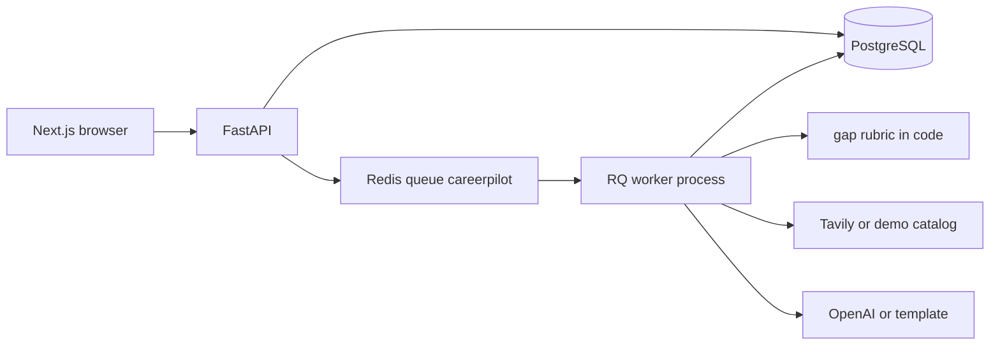

# Architecture

## Frontend

Next.js 15 App Router in `frontend/app`. Shared helpers are in `frontend/src/lib` and `frontend/src/components`. The browser stores the access token in `localStorage` and sends `Authorization: Bearer`. After profile save, the client polls `GET /api/v1/jobs/{id}` until the worker finishes.

Screens: landing, signup, login, profile, dashboard, roadmap.

## Backend

`backend/app/main.py` mounts `backend/app/api.py`. Settings are in `app/config.py`. Sessions are in `app/database.py`.

## Worker

`app/queue.py` enqueues `app.worker.process_assessment_job`. `app/worker.py` marks the job running, calls `app/pipeline.py`, then stores the assessment and roadmap ids on the job. The API process does not run the model or the search.

## Why these boundaries

The interviewer asked for a browser app, a REST API, PostgreSQL, and a real background worker. The pipeline is a straight function chain rather than an agent framework. That keeps failure handling in one place: a failed job row with an error string.
