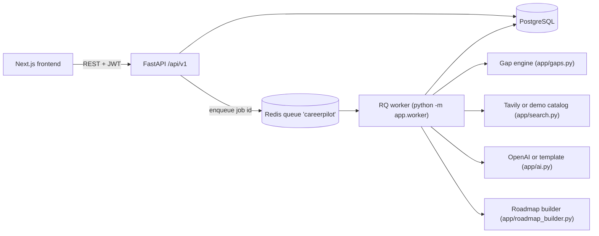
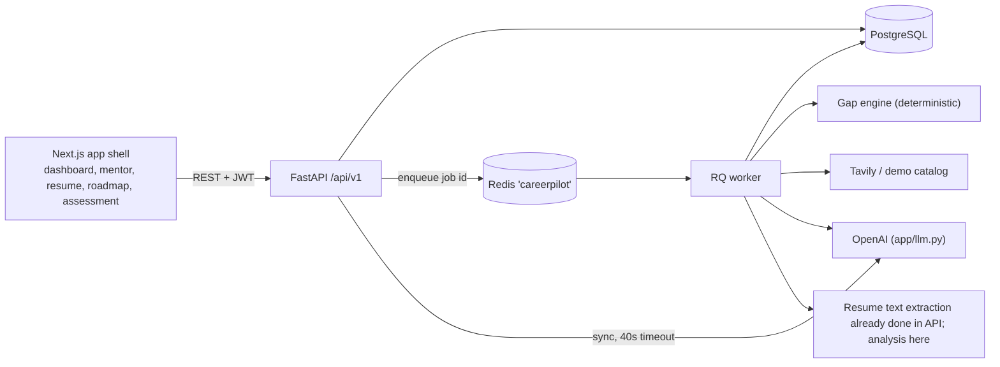

# Architecture

## Components

| Component | Responsibility | Code |
| --- | --- | --- |
| Frontend | Pages, forms, polling, token storage, error messages | `frontend/src/app`, `frontend/src/lib`, `frontend/src/components` |
| API | Auth, profile, job creation, reads, task updates, health | `backend/app/api.py`, `main.py`, `security.py`, `schemas.py` |
| Database | Users, profile, jobs, assessments, resources, roadmaps, tasks | `backend/app/models.py`, `backend/alembic` |
| Queue | Transport for job ids | `backend/app/queue.py` (Redis, RQ) |
| Worker | Runs the pipeline outside the request | `backend/app/worker.py`, `pipeline.py` |
| AI | Narrative text only | `backend/app/ai.py` |
| Resource discovery | Tavily search or labelled catalog | `backend/app/search.py`, `catalog.py` |

## Request flow for an assessment

1. `PUT /profile` stores the profile.
2. `POST /assessments` inserts an `assessment_jobs` row (`queued`), enqueues its id, returns `202`. If Redis is unavailable the row becomes `failed` and the API returns `503`.
3. The worker sets `running`, loads the profile, scores gaps, discovers resources for the focus skills, writes the narrative, builds tasks, inserts assessment + competencies + resources + roadmap + tasks, then sets `completed` with the new ids. Any exception sets `failed` with the message.
4. The dashboard calls `GET /dashboard` (which includes `latest_job`) every two seconds while the job is `queued` or `running`, so a refresh does not lose track of a job. A queued job that stays queued shows a hint to start the worker.

## Cross-cutting behaviour

- **Authorization:** the user comes from the JWT; every read/write filters by `user_id`; foreign ids return `404`.
- **Errors:** validation errors are `422` with field messages; duplicate email `409`; database failures `503` with a migration hint; unexpected errors `500` JSON. The 500 handler sits inside the CORS middleware so the browser sees the real status, not "Failed to fetch".
- **CORS:** `CORS_ORIGINS` plus, outside production, any `localhost`/`127.0.0.1` port.
- **Readiness:** `/health/ready` reports database, migrations (users table present), Redis, and demo/live modes.
- **Windows:** `WindowsWorker` (SimpleWorker, no SIGALRM) when `os.name == "nt"`.

## Deployment shape

Vercel (frontend) → Render web service (API, runs `alembic upgrade head` on build) + Render worker → managed PostgreSQL and Redis. See the README.

## v2 components

| Concern | Where |
| --- | --- |
| Mentor (request/response, bounded history, context builder) | `app/mentor.py`, `app/routes_mentor.py` |
| Roadmap generation and validation | `app/roadmap_ai.py`, `app/roadmap_builder.py` (fallback) |
| Adaptation | `app/adaptive.py`, `pipeline.run_adaptation` |
| Resume | `app/resume_analysis.py`, `app/routes_resume.py`, `worker.run_resume_job` |
| Metrics | `app/metrics.py` |
| LLM client | `app/llm.py` (timeouts, no prompt logging, `LLMError`) |

Jobs: `assessment_jobs.kind` is `assessment`, `adapt` or `resume`; `process_assessment_job` dispatches. The mentor answers inside the request with a timeout because chat must stay responsive; roadmap, adaptation and resume analysis are queued because they are slow. The API extracts resume text synchronously (fast, validates the file), stores only the text on the `resume_analyses` row, and the worker clears it after analysis.
