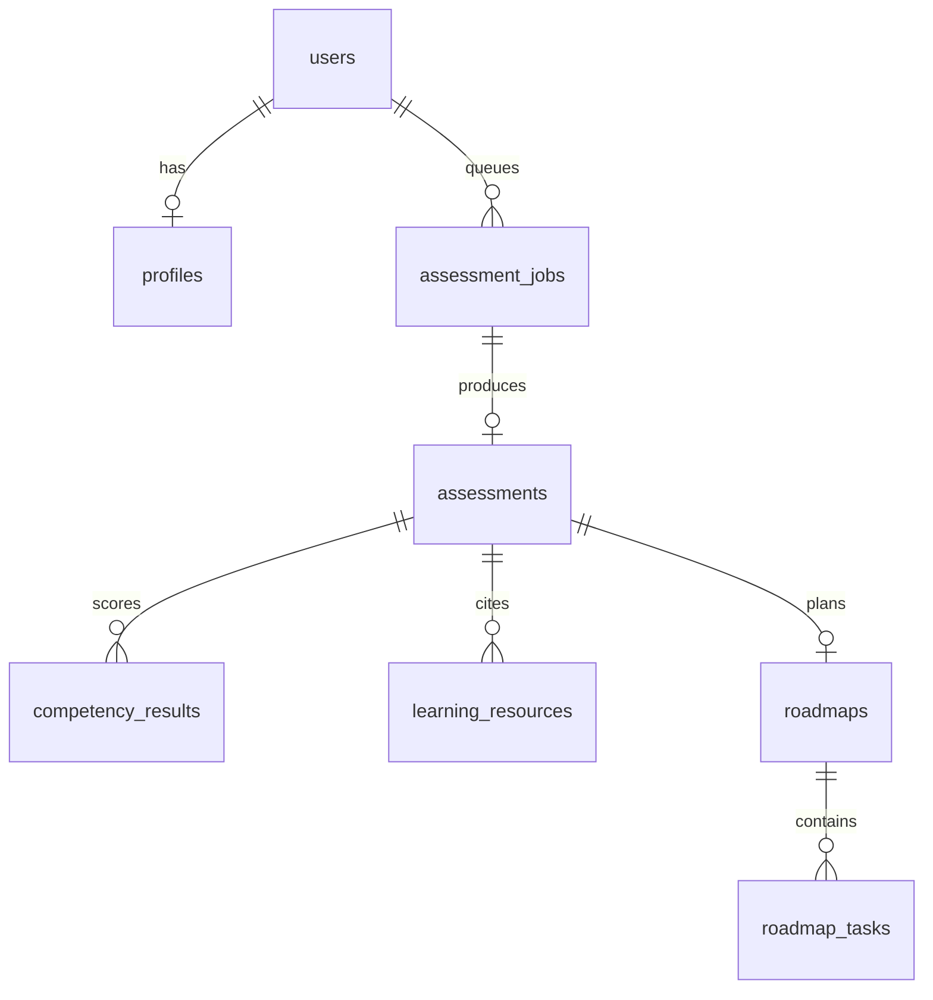

# Data model

Identifiers are UUID strings (portable between PostgreSQL and the SQLite used in tests). Timestamps are timezone-aware. Migration: `backend/alembic/versions/0001_initial.py`.

| Table | Key columns | Notes |
| --- | --- | --- |
| `users` | `id`, `email` (unique, lower-case), `password_hash`, `created_at` | bcrypt hash; unique index decides concurrent signups |
| `profiles` | `user_id` (unique), `full_name`, `education`, `experience_level`, `skills` (JSON `[{name, proficiency}]`), `projects`, `target_career`, `weekly_hours`, `timeline_weeks`, `updated_at` | One per user; `experience_level` is `student`, `fresh_graduate`, or `junior`; timeline 4, 8, or 12 |
| `assessment_jobs` | `user_id`, `status`, `error`, `rq_job_id`, `assessment_id`, `roadmap_id`, `created_at`, `started_at`, `finished_at` | `queued` → `running` → `completed` / `failed` |
| `assessments` | `user_id`, `job_id`, `target_career`, `normalized_role`, `summary`, `learn_first_reason`, `disclaimer`, `provider`, `rubric_version`, `created_at` | `provider` is `openai` or `demo` (narrative source) |
| `competency_results` | `assessment_id`, `user_id`, `name`, `importance`, `target_level`, `self_reported_level`, `status`, `priority_score`, `why_it_matters`, `recommendation`, `sort_order` | `status`: `missing`, `improve`, `sufficient` |
| `learning_resources` | `assessment_id`, `user_id`, `skill`, `title`, `url`, `domain`, `snippet`, `relevance`, `provider` | `provider` is `tavily` or `demo` |
| `roadmaps` | `user_id`, `assessment_id`, `title`, `timeline_weeks`, `weekly_hours`, `overview`, `provider`, `created_at` | |
| `roadmap_tasks` | `roadmap_id`, `user_id`, `week_number`, `objective`, `skills`, `title`, `details`, `estimated_hours`, `expected_outcome`, `completion_criteria`, `resources` (JSON), `status`, `notes`, `sort_order`, `completed_at` | Unique `(roadmap_id, sort_order)`; `status`: `pending`, `in_progress`, `completed` |

`user_id` is stored on every owned table so queries reject another user's ids without a join. Completion percentage is `round(completed_tasks * 100 / total_tasks)`, computed by the API and never stored.

## v2 tables and columns (migration `0002_ai_features`)

| Table / column | Notes |
| --- | --- |
| `assessment_jobs.kind`, `params` | `assessment` / `adapt` / `resume`; JSON parameters (adapt mode and focus skill, resume id) |
| `roadmaps.source` | `ai` or `fallback` |
| `roadmaps.milestones` | JSON list of `{week, title}` |
| `roadmaps.adapted_count`, `adaptation_note` | Revision history summary |
| `mentor_conversations` | `user_id`, `title`, `created_at`, `updated_at` |
| `mentor_messages` | `conversation_id`, `user_id`, `role` (`user`/`assistant`), `content`, `provider` (`openai`/`demo`), `notice`, `created_at` |
| `resume_analyses` | `user_id`, `filename`, `status`, `provider`, `notice`, `error`, `source_text` (cleared after analysis), `analysis` (JSON), `comparison` (JSON), `created_at` |

All new tables carry `user_id`; every query filters by it and foreign ids return `404`.

`resume_analyses.source_text` lifecycle: set at upload, cleared on success, on failure, and by a 1-hour purge for jobs that never ran. `analysis.skills[].usage` stores the model's one-sentence usage statement for demonstrated skills only.
